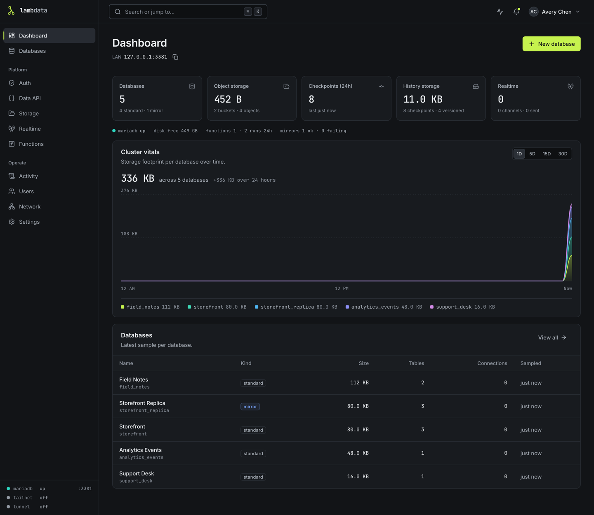
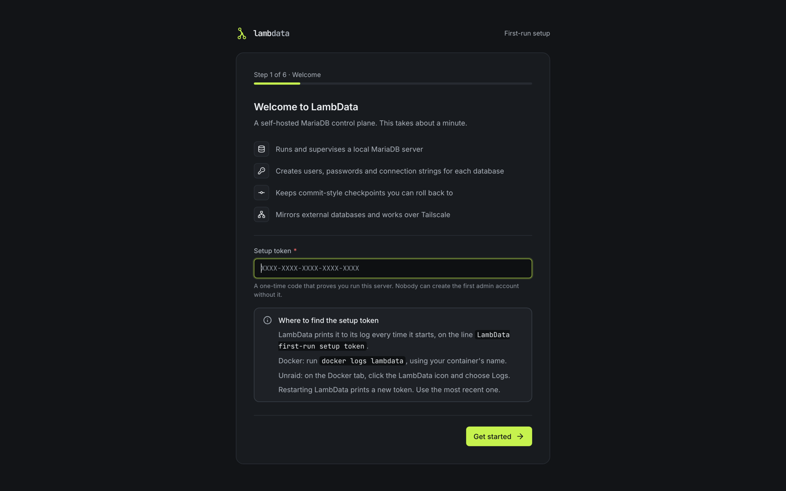
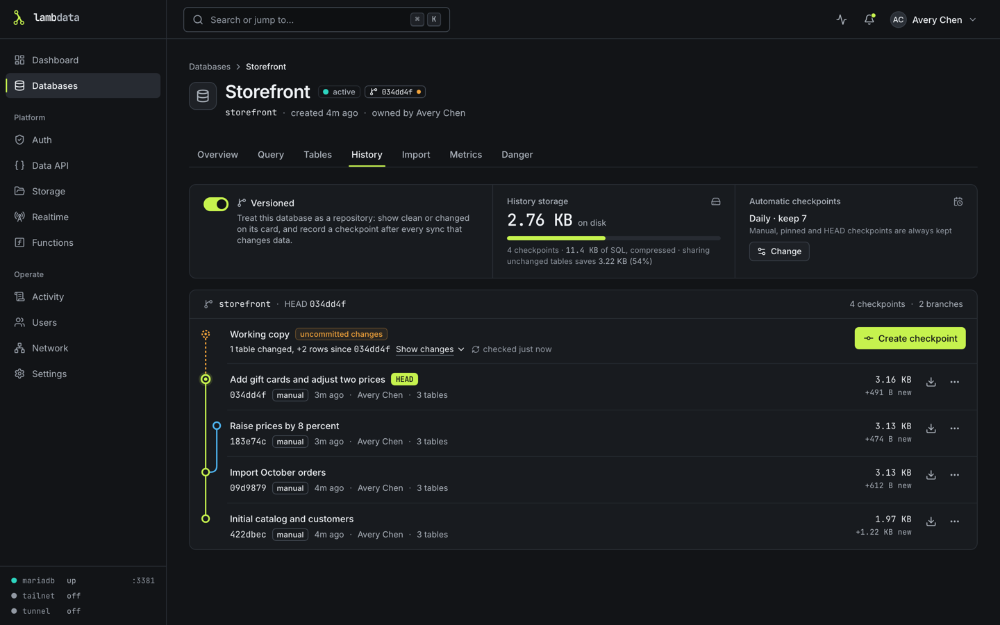
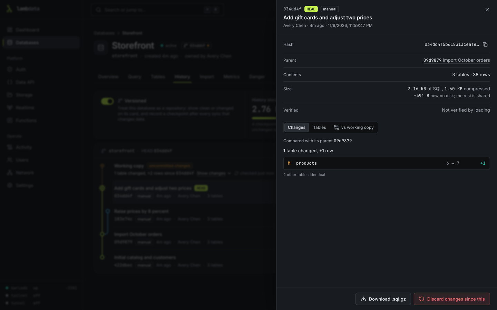
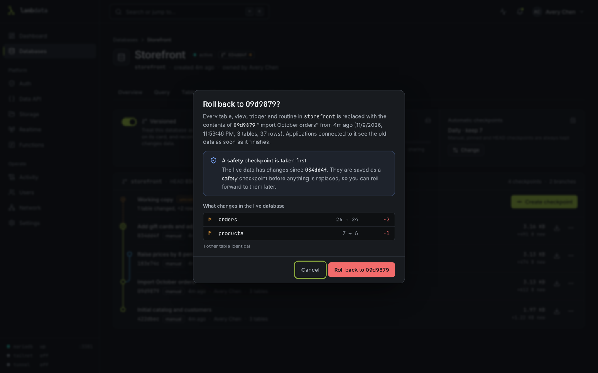
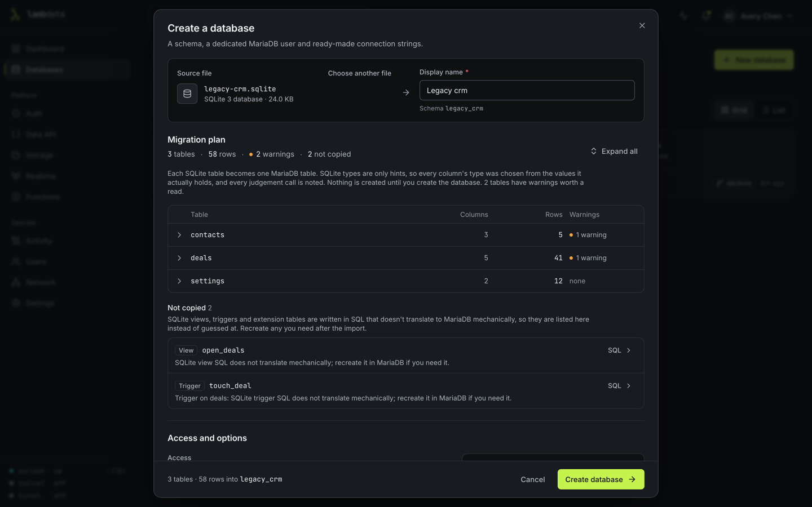
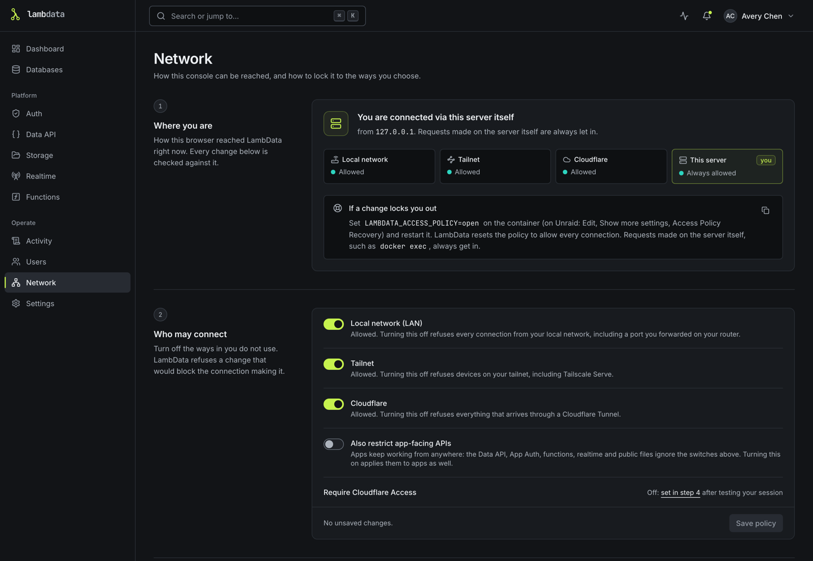
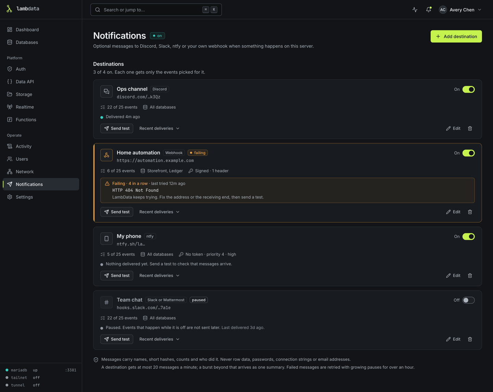
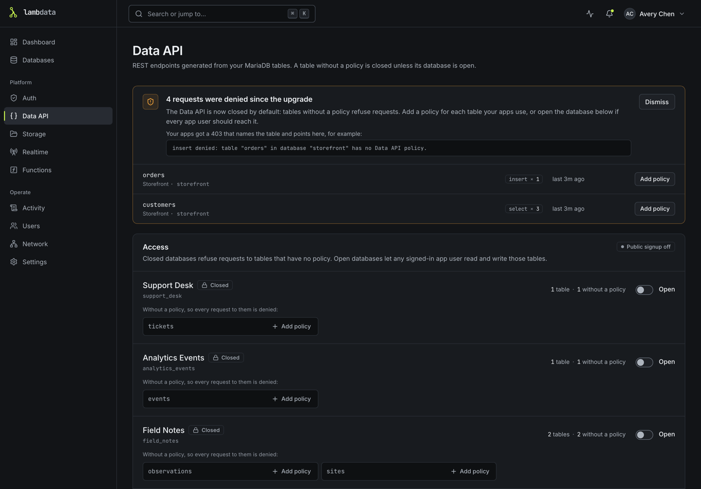

# LambData

A self-hosted MariaDB control plane for your home server. LambData runs its own MariaDB and gives you a web console to create databases, keep commit-style checkpoints you can roll back to, turn a SQLite file or SQL dump into a database, mirror other databases, and serve a Data API, App Auth, Realtime, Functions and Storage to your apps. Everything runs in one Docker container with one data folder.

LambData was called KilnDB. If you run KilnDB today, read [Upgrading from KilnDB](#upgrading-from-kilndb) before you switch.



## What you can do

- **Create databases.** Each one gets its own schema, its own MariaDB user and password (shown once) and ready-to-copy connection strings. Limit where it can be reached from, including tailnet only.
- **Keep checkpoints and roll back.** Save a database's state at any moment without stopping it, automatically every day or whenever you like. See what changed, download a checkpoint as SQL, and roll back, with a safety checkpoint taken first. [More about checkpoints](docs/checkpoints.md).
- **Create a database from a file.** Drop in a SQLite file (a game server's `sv.db`, any `.db`, `.sqlite` or `.sqlite3`) or a MySQL/MariaDB dump, check the plan, and get a MariaDB database. [More about importing](docs/importing.md).
- **Mirror other databases.** Copy a MySQL, MariaDB or PostgreSQL database on a schedule. A versioned mirror records a checkpoint after each sync that changed data.
- **Serve your apps.** A REST Data API over your tables with per-table policies, App Auth for your apps' users, Realtime WebSocket channels, TypeScript functions and file storage.
- **Choose who can reach the console.** Your local network, your Tailscale tailnet, a Cloudflare Tunnel behind Cloudflare Access, or any mix. [More about network access](docs/network.md).
- **Get notified.** Optional messages to Discord, Slack or Mattermost, your phone through ntfy, or a signed webhook when a database is created, a checkpoint is made, a rollback is refused, a mirror stops syncing or the disk runs low. Off until an admin adds a destination. [More about notifications](docs/notifications.md).
- **Share it safely.** Console users are admins, database owners or read-only viewers.

## Install

LambData needs one port for the console (4317) and one place to keep its data. It runs on amd64 and arm64.

### Unraid

From the Unraid terminal, add the template:

```bash
mkdir -p /boot/config/plugins/dockerMan/templates-user
curl -fsSL \
  https://raw.githubusercontent.com/lambdatadb/lambdata/main/unraid/lambdata.xml \
  -o /boot/config/plugins/dockerMan/templates-user/my-LambData.xml
```

Then on the **Docker** tab click **Add Container**, choose **LambData** and click **Apply**. The template uses `ghcr.io/lambdatadb/lambdata:latest`, port `4317`, and keeps everything in `/mnt/user/appdata/lambdata`. See [Unraid deployment](docs/unraid.md) for Tailscale, updates and backups.

### Docker

```bash
docker run -d \
  --name lambdata \
  --restart unless-stopped \
  --stop-timeout 45 \
  -p 4317:4317 \
  -v lambdata-data:/data \
  ghcr.io/lambdatadb/lambdata:latest
```

`--stop-timeout 45` gives LambData time to shut MariaDB down cleanly; keep it at 30 seconds or more. To update, pull the new image, remove the container (`docker rm -f lambdata`; the volume stays) and run the same command again.

### Docker Compose

The included [`docker-compose.yml`](docker-compose.yml) builds the image from this repository:

```bash
git clone https://github.com/lambdatadb/lambdata.git
cd lambdata
docker compose up -d --build
```

Its data volume is named `kilndb_kilndb-data`, the name the KilnDB version of the file used, so existing installs keep their data. `docker compose down` keeps the volume; `docker compose down -v` deletes it.

### First start

Open `http://<server>:4317`. The setup wizard asks for a **setup token**, a one-time code LambData prints in its log when it starts:

- Docker: `docker logs lambdata` and look for the line `LambData first-run setup token:`.
- Unraid: on the **Docker** tab, click the LambData icon and choose **Logs**.



Restarting before setup is finished prints a new token; use the most recent one. The wizard then creates the first admin account. There is no default user or password. Finish setup before you expose the console to anyone else.

## Upgrading from KilnDB

> **Back up first.** Stop the container and copy the whole data folder (Unraid: `/mnt/user/appdata/kilndb`) or volume before switching. The full guide is [Upgrading from KilnDB](docs/upgrading.md).

- **Switch deliberately.** The KilnDB image is no longer published. An existing KilnDB container keeps running the last KilnDB version until you change its repository to `ghcr.io/lambdatadb/lambdata:latest` yourself. The data path and the `KILNDB_*` variables can stay as they are.
- **Your data stays.** Same data folder, same database users, same App Auth issuer. Docker Compose users: the new file uses the old volume name; stop the old `kilndb` container first.
- **The Data API starts closed.** Tables without a Data API policy now refuse app requests. The **Data API** page lists what was refused and lets you add policies or open a database again.
- **App Auth sign-up is off** unless an admin had switched it on. Turn it back on from the **Auth** page if your apps need it.
- **Snapshots become checkpoints** at the first start. The originals are kept for 30 days in `snapshots/converted/`. A snapshot that cannot be converted is listed in that database's History with the reason and retried at each start and about once an hour.
- **Reload** browser tabs that were open across the upgrade.
- **Behind a reverse proxy or tunnel**, if the console says "Request blocked", list its public address under **Network**, **Public URLs**.
- **Give it time to stop:** at least 30 seconds (`stop_grace_period` in Compose, `--stop-timeout=45` under **Extra Parameters** on Unraid).
- **Going back** to KilnDB on the upgraded folder signs everyone out and invalidates App Auth tokens, because signing secrets are now stored encrypted. Restore your backup instead.

Each database also has a new **Show in dashboard vitals** switch on its Overview tab.

## Checkpoints

Every database gets a daily checkpoint by default, kept for a week, and you can make your own at any time with a message. Taking one never stops the database, and tables that did not change are stored only once. Mark a database **versioned** to see on its card whether it changed since its last checkpoint.



Open a checkpoint to see what changed since the one before it, or since then in the live database:



Rolling back loads the checkpoint into a scratch copy first and checks it against what was recorded, then saves a safety checkpoint of the current state, checks that nothing else changed the database in the meantime, and swaps the tables in. Applications that use the database's own account are disconnected only for that last part. If anything does not match, nothing is changed.



Details, limits and the rules for mirrors: [Checkpoints](docs/checkpoints.md).

## Create a database from a file

Choose **New database**, then **Import**, and drop a SQLite file or a SQL dump. LambData reads it and shows a plan: every table, its rows, and the MariaDB type chosen for each column from the values it actually holds. Nothing is created until you confirm. 64-bit numbers such as SteamID64 values are kept exact. The same works on an existing database's **Import** tab to replace its contents, after a safety checkpoint.



More: [Create a database from a file](docs/importing.md).

## Network access

The **Network** page shows how you are connected and lets an admin choose which ways in are allowed: local network, tailnet, Cloudflare. It can run a Cloudflare Tunnel for you and check Cloudflare Access sign-ins. Nothing is restricted until you change it.



More: [Network access](docs/network.md).

## Notifications

LambData can tell you when something happens: in a Discord channel, a Slack or Mattermost channel, on your phone through ntfy, or at your own endpoint (Home Assistant, n8n, Node-RED) as signed JSON. It is off until an admin adds a destination on the **Notifications** page, and each destination gets only the events and databases picked for it. Messages carry names, short hashes, counts and who did it, never row data, passwords or connection strings.



More, including the webhook format and how to check its signature: [Notifications](docs/notifications.md).

## Data API, App Auth, Realtime and Functions

The **Data API** page lists every table, its policy and its endpoint, and generates an OpenAPI 3.1 document. A table without a policy is closed unless its database is opened.



Create an app user on the **Auth** page, then exchange email and password for a token:

```bash
curl -X POST http://localhost:4317/api/app-auth/token \
  -H 'Content-Type: application/json' \
  --data '{"email":"user@example.com","password":"your-password"}'
```

Use the returned `accessToken` with a table endpoint:

```bash
curl 'http://localhost:4317/api/data/app_db/todos?select=id,title&order=id.desc' \
  -H 'Authorization: Bearer <accessToken>'
```

The Data API supports `GET`, `POST`, `PATCH` and `DELETE`; `select`, `order`, `limit` and `offset`; and the filters `eq`, `neq`, `gt`, `gte`, `lt`, `lte`, `like`, `ilike` and `in`. Policies allow or deny each operation per table and can limit rows to their owner.

Realtime: subscribe to changes made through the Data API.

```js
const socket = new WebSocket("ws://localhost:4317/api/realtime/v1/websocket?token=<accessToken>");
socket.addEventListener("open", () => {
  socket.send(JSON.stringify({ type: "subscribe", channel: "db:app_db:table:todos" }));
});
socket.addEventListener("message", (event) => console.log(JSON.parse(event.data)));
```

Functions are TypeScript files that admins write in the console (stored in `<data folder>/functions/<name>/index.ts`):

```ts
export default async function handler(request, context) {
  return Response.json({ ok: true, function: context.functionName, method: request.method });
}
```

```bash
curl http://localhost:4317/functions/v1/hello -H 'Authorization: Bearer <accessToken>'
```

Functions run with the same rights as LambData itself. Only admins can write them; treat that like giving shell access. See [SECURITY.md](SECURITY.md).

## Limits and safety

- LambData keeps free space on the data volume (10% of it, at most 5 GB, by default) so MariaDB can keep running. Below that, uploads, files in Storage, checkpoints, rollbacks, imports, syncs and Data API inserts and updates are refused with a clear message. SQL run in the Query tab, and applications connected to MariaDB directly, are not limited.
- Imports accept files up to 2 GB by default, and each user can have 5 uploads waiting.
- Admins can cap how many automatic checkpoints database owners keep and how often they run.
- Viewers are read-only everywhere and use a read-only MariaDB account in the SQL editor.
- Functions are trusted code written by admins; there is no sandbox.

All limits, their defaults and variables, and how to report a security problem: [SECURITY.md](SECURITY.md).

## Configuration

No environment variables are needed for the default Docker setup. Every `LAMBDATA_*` variable except the new `LAMBDATA_FIX_DATA_OWNERSHIP` can also be given with the old `KILNDB_*` prefix; when both are set, `LAMBDATA_*` wins.

| Variable | Default | Purpose |
|---|---|---|
| `PORT` | `4317` | Console and API port |
| `HOST` | `127.0.0.1`, `0.0.0.0` in Docker | Address the console listens on |
| `LAMBDATA_DATA_DIR` | `<repo>/.lambdata`, `/data` in Docker | Data folder |
| `LAMBDATA_MARIADB_PORT` | `3307` | Port of the managed MariaDB |
| `LAMBDATA_MARIADB_BIND` | `127.0.0.1` | Address MariaDB listens on |
| `LAMBDATA_MARIADB_BIN` | found on `PATH` | Path to `mariadbd` |
| `LAMBDATA_COOKIE_SECURE` | `0` | `1` forces Secure session cookies. Not needed for HTTPS: cookies become Secure on their own there. |
| `LAMBDATA_EXTRA_ORIGINS` | empty | Extra console addresses, comma-separated, for proxies that rewrite the `Host` header and for web apps on other addresses |
| `LAMBDATA_ACCESS_POLICY` | empty | `open` resets a network policy that locked you out |
| `LAMBDATA_TRUST_LOOPBACK` | on | `0` (or `false`, `no`, `off`) treats no connection from this machine as local. For a forwarder on the same machine; see [Network access](docs/network.md#a-forwarder-on-the-same-machine) |
| `LAMBDATA_FENCE_MAX_MINUTES` | `120` | Longest a rollback, replacing import or sync may keep a database closed to its own account |
| `LAMBDATA_TAILSCALE_BIN`, `LAMBDATA_CLOUDFLARED_BIN` | found on `PATH` | Use a specific `tailscale` or `cloudflared` |
| `LAMBDATA_FIX_DATA_OWNERSHIP` | `auto` | Docker only. `never` stops the container instead of fixing the owner of files in the data folder |
| `LAMBDATA_WEB_ORIGIN` | `http://localhost:5173` | Console address during development |
| `LAMBDATA_WEB_DIST` | `/app/apps/web/dist` in Docker | Built console the API serves |

Limits (`LAMBDATA_DISK_FLOOR`, `LAMBDATA_IMPORT_MAX_BYTES` and others) are listed in [SECURITY.md](SECURITY.md#limits).

### Connecting to databases from outside Docker

MariaDB listens only inside the container by default. To let MySQL clients on your network connect, publish its port and bind it to all addresses:

```yaml
services:
  lambdata:
    ports:
      - "4317:4317"
      - "3307:3307"
    environment:
      LAMBDATA_MARIADB_BIND: "0.0.0.0"
```

Only do this on a network you trust, and set each database's "connections from" setting as narrowly as you can instead of `%`.

## Data and backups

Everything lives in one data folder (`/data` in the container):

```text
data/
├── metadata.sqlite      users, settings, databases, checkpoint records
├── master.key           encrypts stored passwords and secrets
├── mariadb/             MariaDB's own files
├── checkpoints/         checkpoint data, shared between checkpoints
├── snapshots/converted/ KilnDB snapshot files, kept 30 days after conversion
├── imports/             uploads waiting to be imported
├── storage/             Storage buckets
├── functions/           function source
└── logs/
```

Back up the whole folder or volume, with the container stopped so MariaDB's files are consistent. Without `master.key` the stored passwords and secrets cannot be decrypted, so a backup without it is incomplete. Checkpoints protect against mistakes inside a database; they are not a backup, because they live in the same folder.

## Development

Install [Bun](https://bun.sh) and MariaDB (`mariadbd`, `mariadb-install-db`, `mariadb-admin`, `mariadb`, `mariadb-dump`), then:

```bash
bun install
bun run dev
```

The API runs on `127.0.0.1:4317`, the console on <http://localhost:5173>, and MariaDB on `127.0.0.1:3307`. Checks, tests and the screenshot script are described in [CONTRIBUTING.md](CONTRIBUTING.md). Changes are listed in [CHANGELOG.md](CHANGELOG.md).

## Current limitations

- Data API policies apply to requests through LambData. Applications that connect to MariaDB directly are governed by MariaDB's grants.
- Realtime carries Data API changes and app broadcasts; it does not follow changes made directly in MariaDB, and it does not keep events for replay.
- Functions run as separate processes with time limits, not in containers or virtual machines.
- Storage keeps files on the local disk and does not speak the S3 protocol.
- PostgreSQL is supported only as a mirror source.
- Views, triggers and routines that read another database are not re-created automatically by rollbacks and mirror syncs. See [Checkpoints](docs/checkpoints.md#limits).

## License

[MIT](LICENSE)
