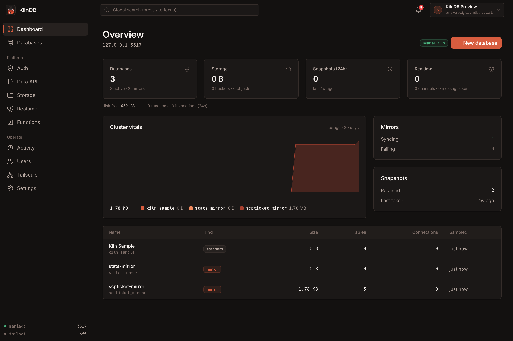
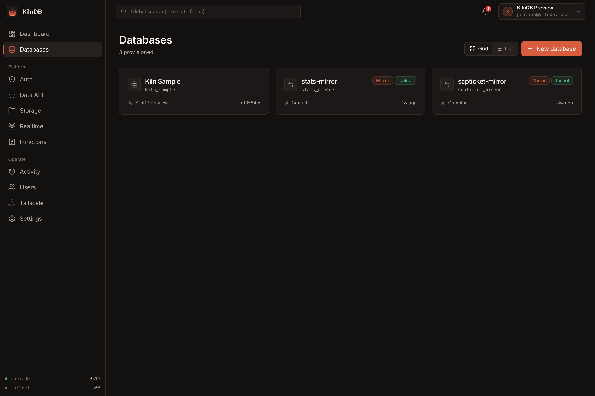
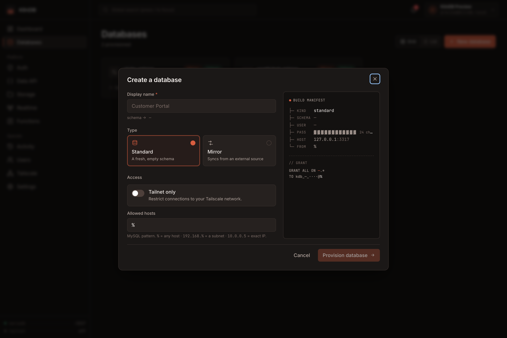
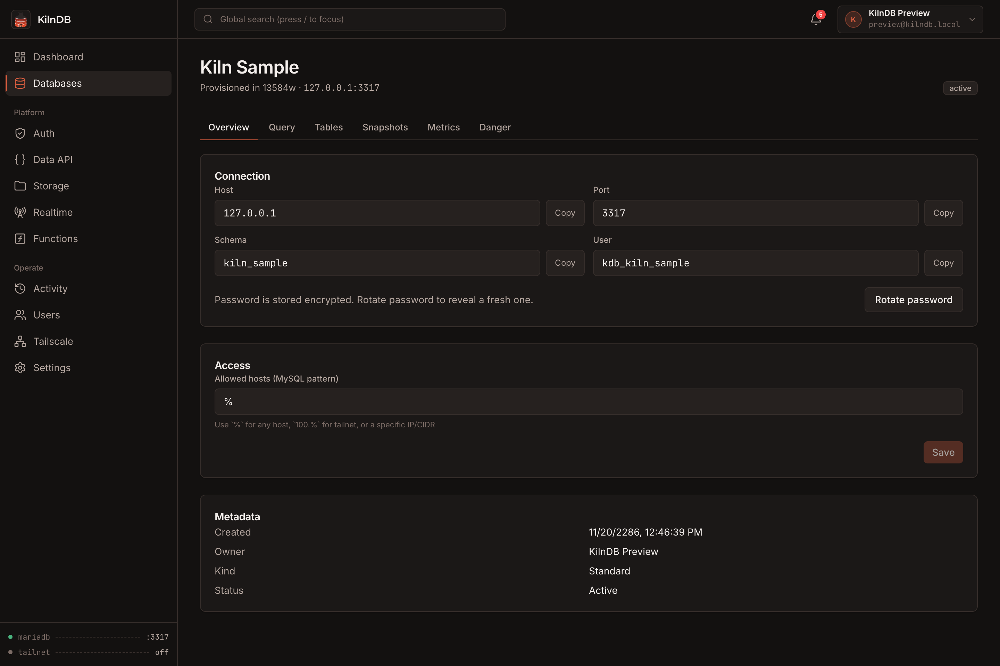
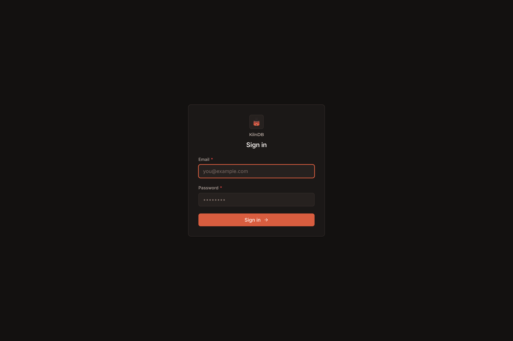
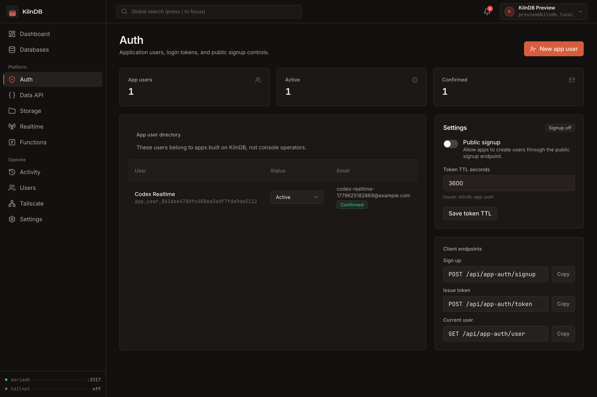
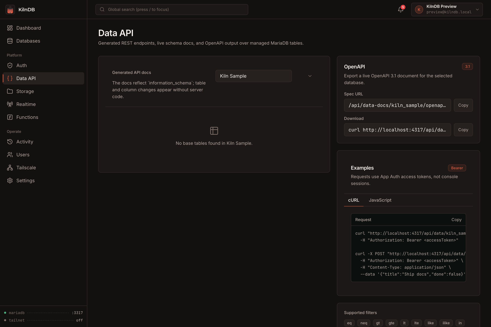
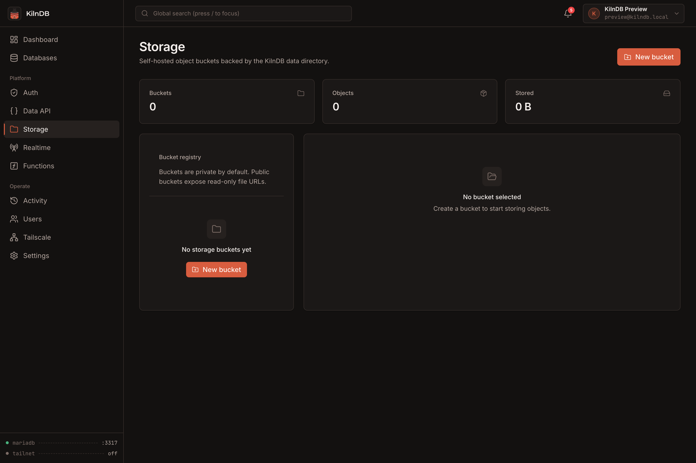
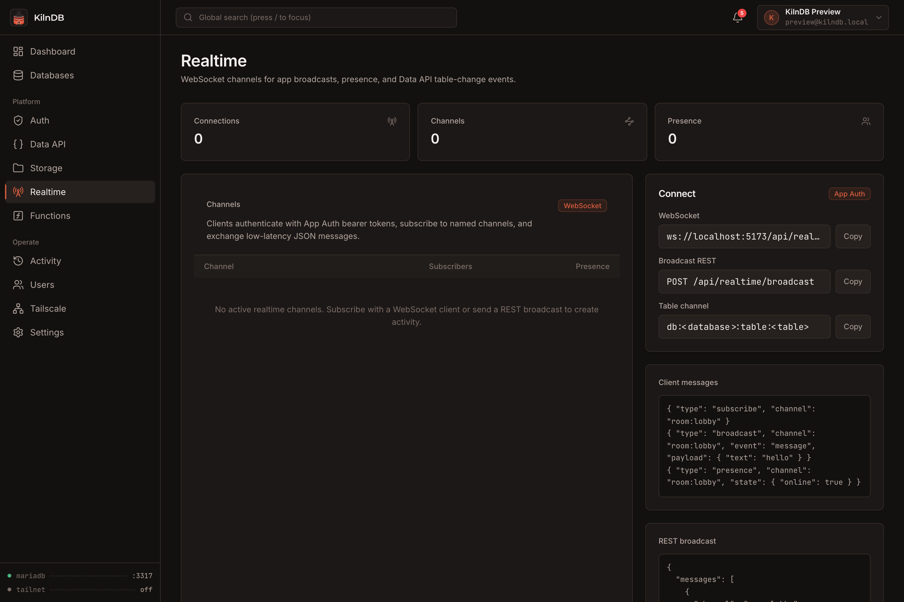
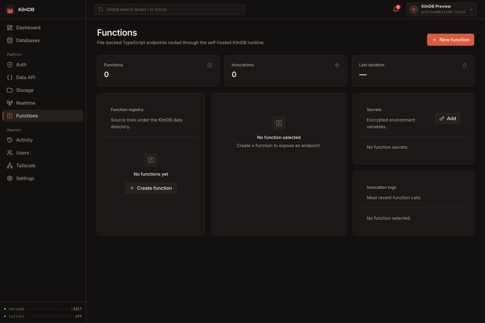

# KilnDB

Self-hosted database infrastructure for MySQL and MariaDB, packaged as one control plane.

KilnDB provisions databases, generates credentials, mirrors external data, takes snapshots, exposes a REST Data API, runs TypeScript functions, serves realtime channels, and manages local object storage from a single web console. It supervises its own MariaDB instance, so there is no separate application database to configure first.

> One console, one API port, one persistent data directory.



## Highlights

- **Database provisioning** — create an isolated schema and least-privilege MariaDB user from one form, with one-time credentials and ready-to-copy connection strings.
- **Mirrors and snapshots** — sync from MySQL, MariaDB, or PostgreSQL sources; create on-demand or scheduled SQL snapshots and restore them from the console.
- **Generated Data API** — expose reflected tables through authenticated `GET`, `POST`, `PATCH`, and `DELETE` endpoints with filtering, ordering, pagination, policies, and generated OpenAPI 3.1 docs.
- **App Auth** — manage application users separately from console operators and issue bearer JWTs for the Data API, Realtime, and Functions.
- **Realtime** — use authenticated WebSocket channels for broadcast, presence, and Data API mutation events.
- **TypeScript Functions** — create and invoke file-backed functions with optional JWT verification, encrypted secrets, and invocation logs.
- **Object storage** — manage private or public filesystem-backed buckets with upload, overwrite, download, and deletion controls.
- **Operations** — inspect database size, rows, tables, connections, write activity, audit history, and service health.
- **Access control** — assign `admin`, `db_owner`, and `viewer` roles and optionally expose databases through Tailscale.

## Screenshots

| Databases | Create a database |
|---|---|
|  |  |

| Database detail | Sign in |
|---|---|
|  |  |

| App Auth | Generated Data API |
|---|---|
|  |  |

| Object storage | Realtime channels |
|---|---|
|  |  |

| TypeScript Functions |
|---|
|  |

## Quick start

Both Docker setups persist the complete installation—including MariaDB, metadata, snapshots, storage objects, functions, and the encryption key—in a named volume.

### Option 1: Docker Compose

The included [`docker-compose.yml`](docker-compose.yml) is the recommended setup. From the repository root:

```bash
docker compose up -d --build
```

Open <http://localhost:4317> and complete the first-run setup. No default username or password is created.

Useful commands:

```bash
# Follow application and MariaDB startup logs
docker compose logs -f kilndb

# Stop the service without deleting its data
docker compose down

# Rebuild and restart after pulling an update
docker compose up -d --build
```

`docker compose down` leaves the data volume intact. Back up the `kilndb-data` volume before destructive maintenance or upgrades.

The included Compose setup is equivalent to:

```yaml
services:
  kilndb:
    build: .
    image: kilndb:latest
    container_name: kilndb
    restart: unless-stopped
    ports:
      - "4317:4317"
    volumes:
      - kilndb-data:/data

volumes:
  kilndb-data:
```

### Option 2: Docker Run

Build the image and start a container directly:

```bash
docker build -t kilndb:latest .

docker run -d \
  --name kilndb \
  --restart unless-stopped \
  -p 4317:4317 \
  -v kilndb-data:/data \
  kilndb:latest
```

Then open <http://localhost:4317>. Docker creates the `kilndb-data` volume automatically.

Useful commands:

```bash
# Follow startup and runtime logs
docker logs -f kilndb

# Stop and restart the existing container
docker stop kilndb
docker start kilndb

# Remove the container without deleting its named data volume
docker rm -f kilndb
```

To rebuild after an update while preserving data:

```bash
docker rm -f kilndb
docker build -t kilndb:latest .
docker run -d \
  --name kilndb \
  --restart unless-stopped \
  -p 4317:4317 \
  -v kilndb-data:/data \
  kilndb:latest
```

### Local development

Install [Bun](https://bun.sh) and MariaDB client/server tools, then run:

```bash
bun install
bun run dev
```

The API starts on `127.0.0.1:4317`, Vite starts on `127.0.0.1:5173`, and the managed MariaDB process uses `127.0.0.1:3307` by default.

Required MariaDB executables are `mariadbd`, `mariadb-install-db`, `mariadb-admin`, `mariadb`, and `mariadb-dump`. Package names vary by platform; on macOS use `brew install mariadb`, and on Debian or Ubuntu use `sudo apt install mariadb-server mariadb-client`.

## How it works

```text
Browser :4317
      │
      ▼
┌──────────────────────────────────────────────┐
│ Bun + Hono                                   │
│ Web console · REST API · Data API            │
│ Realtime · Functions · background workers    │
└───────────────┬──────────────────────┬───────┘
                │                      │
                ▼                      ▼
       metadata.sqlite       managed MariaDB :3307
                │                      │
                └──────────┬───────────┘
                           ▼
              snapshots · storage · functions
                    persistent data directory
```

The API initializes and supervises MariaDB, stores control-plane metadata in `bun:sqlite`, and serves the built React console in production. The Docker image runs both processes as an unprivileged `kilndb` user.

## Configuration

No environment variables are required for the default Docker setup.

| Variable | Default | Purpose |
|---|---:|---|
| `PORT` | `4317` | Console and API port |
| `HOST` | `127.0.0.1` locally, `0.0.0.0` in Docker | API bind address |
| `KILNDB_DATA_DIR` | `<repo>/.kilndb` locally, `/data` in Docker | Persistent state directory |
| `KILNDB_MARIADB_PORT` | `3307` | Managed MariaDB port |
| `KILNDB_MARIADB_BIND` | `127.0.0.1` | MariaDB bind address |
| `KILNDB_MARIADB_BIN` | auto-detected | Explicit path to `mariadbd` |
| `KILNDB_COOKIE_SECURE` | `0` | Set to `1` when the console is served over HTTPS |
| `KILNDB_WEB_ORIGIN` | `http://localhost:5173` | Primary development CORS origin |
| `KILNDB_EXTRA_ORIGINS` | empty | Comma-separated additional CORS origins |
| `KILNDB_WEB_DIST` | unset locally, `/app/apps/web/dist` in Docker | Static console build served by the API |

### Connecting to databases from outside Docker

MariaDB listens only inside the container by default. To connect an external MySQL client, publish its port and opt into a non-loopback bind:

```yaml
services:
  kilndb:
    ports:
      - "4317:4317"
      - "3307:3307"
    environment:
      KILNDB_MARIADB_BIND: "0.0.0.0"
```

Only expose the database port on a trusted network. Restrict each provisioned database's allowed-host pattern instead of using `%` when possible.

### HTTPS

Put KilnDB behind a TLS-terminating reverse proxy and set:

```yaml
environment:
  KILNDB_COOKIE_SECURE: "1"
```

## Core workflows

### Provision a database

Open **Databases → New database**, choose a standard or mirror database, and set its allowed-host pattern. KilnDB creates a schema, generates a dedicated user and password, applies grants, encrypts the stored credential, and presents the password once.

### Use App Auth and the Data API

Create or enable an application user from **Auth**, then exchange credentials for a bearer token:

```bash
curl -X POST http://localhost:4317/api/app-auth/token \
  -H 'Content-Type: application/json' \
  --data '{"email":"user@example.com","password":"your-password"}'
```

Use the returned `accessToken` with a reflected table endpoint:

```bash
curl 'http://localhost:4317/api/data/app_db/todos?select=id,title&order=id.desc' \
  -H 'Authorization: Bearer <accessToken>'
```

Supported operations and query controls include:

- `GET`, `POST`, `PATCH`, and `DELETE`
- `select`, `order`, `limit`, and `offset`
- `eq`, `neq`, `gt`, `gte`, `lt`, `lte`, `like`, `ilike`, and `in` filters
- per-table method gates and optional owner-column scoping
- generated OpenAPI 3.1 documents from the **Data API** console

### Subscribe to Realtime

```js
const socket = new WebSocket(
  "ws://localhost:4317/api/realtime/v1/websocket?token=<accessToken>",
);

socket.addEventListener("open", () => {
  socket.send(JSON.stringify({
    type: "subscribe",
    channel: "db:app_db:table:todos",
  }));
});

socket.addEventListener("message", (event) => {
  console.log(JSON.parse(event.data));
});
```

Writes made through the Data API emit events to database and table channels. Realtime also supports application broadcasts and presence state.

### Create a function

Functions live at `<data-dir>/functions/<name>/index.ts` and may also be created in the console:

```ts
export default async function handler(request, context) {
  return Response.json({
    ok: true,
    function: context.functionName,
    method: request.method,
  });
}
```

Invoke a protected function with an App Auth token:

```bash
curl http://localhost:4317/functions/v1/hello \
  -H 'Authorization: Bearer <accessToken>'
```

## Data and backups

Everything needed to restore an installation lives in one data directory:

```text
data/
├── metadata.sqlite
├── master.key
├── mariadb/
├── snapshots/
├── storage/
├── functions/
└── logs/
```

Back up the entire directory or Docker volume. The `master.key` is required to decrypt stored credentials and function secrets, so a backup without it is incomplete.

For a consistent filesystem-level backup, stop KilnDB before copying the data directory. Database-level snapshots can be created and restored while the service is running.

## Security model

- Console passwords are hashed with `Bun.password`; console sessions use an HTTP-only, `SameSite=Lax` JWT cookie.
- App Auth uses a separate bearer-token secret and audience.
- Database credentials, function secrets, and Tailscale auth keys are encrypted with AES-256-GCM using the installation's `master.key`.
- The Data API validates database, table, column, ordering, and filter identifiers before building SQL.
- Public storage reads are available only for buckets explicitly marked public; mutations still require an authorized console role.
- Functions run in separate Bun subprocesses with an invocation timeout. Function source is trusted local code, not a hardened multi-tenant sandbox.
- MariaDB and the API bind to loopback addresses by default during local development.

Please report security issues privately as described in [SECURITY.md](SECURITY.md).

## Project structure

```text
kilndb/
├── apps/
│   ├── api/              Bun + Hono API and workers
│   └── web/              React + Vite console
├── packages/shared/      shared types and terminology
├── docs/screenshots/     README images
├── scripts/              development and visual checks
├── Dockerfile
├── docker-compose.yml
└── package.json
```

## Development checks

```bash
bun run typecheck
bun run build
```

See [CONTRIBUTING.md](CONTRIBUTING.md) for the contribution workflow and [CHANGELOG.md](CHANGELOG.md) for notable changes.

## Current limitations

- Data API policies are enforced at the KilnDB API layer; direct MariaDB connections use MariaDB grants and are not covered by those policies.
- Realtime emits Data API mutations and application broadcasts; it does not tail the MariaDB binlog or persist events for replay.
- Functions provide process-level separation and timeouts, not container or VM isolation.
- Storage is local filesystem-backed and does not implement the S3 protocol.
- PostgreSQL support is limited to importing mirror data into MariaDB.

## License

[MIT](LICENSE)
