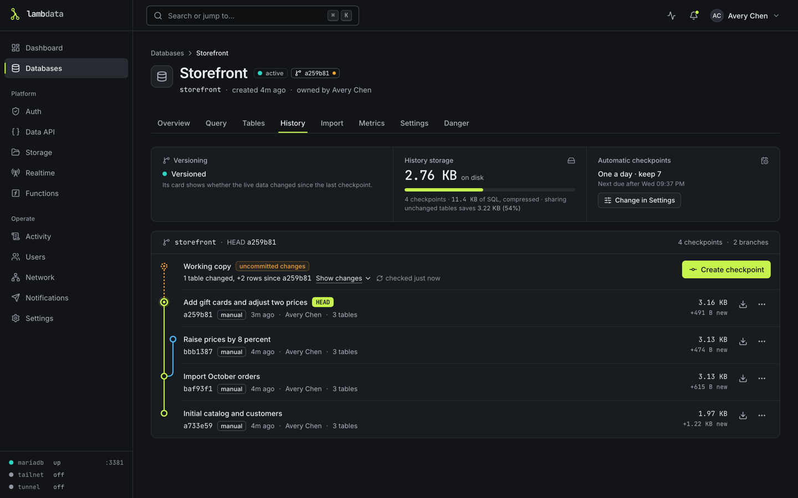
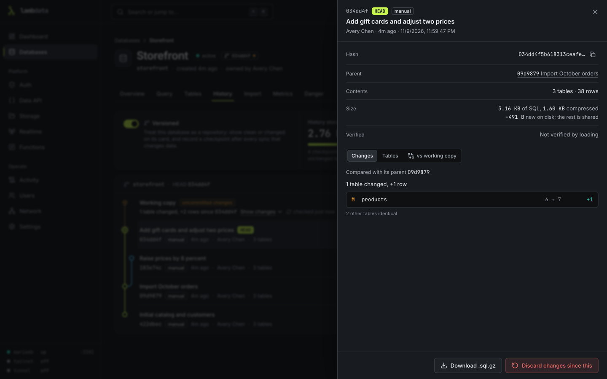
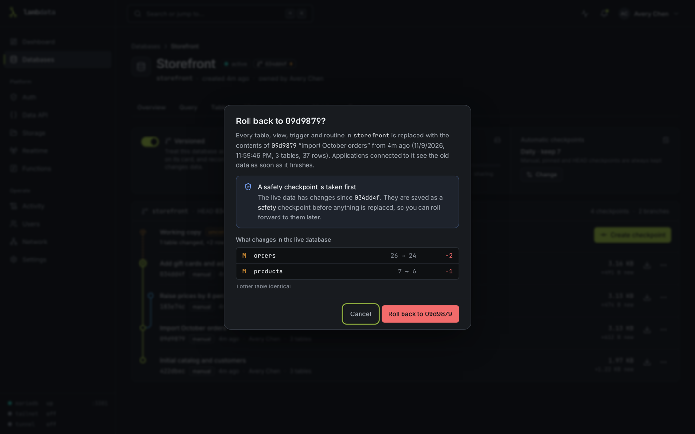

# Checkpoints

A checkpoint is a saved copy of one database at one moment: its tables, rows, views, triggers, routines and events, and its default character set. You can look at what changed between checkpoints, download one as SQL, and roll the database back to one. Checkpoints work like commits in git: each one points at the one before it, and a rollback starts a new branch from an older one.

Taking a checkpoint never stops the database. Applications keep reading and writing while it is saved. Tables that did not change since an earlier checkpoint are stored once and shared, so a new checkpoint only takes space for the tables that changed.

Everything lives on the database's **History** tab.



## Settings

Each database has a **Settings** tab. It holds every setting on this page in one place: versioning, the sync schedule (mirrors), how often an automatic checkpoint is taken, how many to keep, **Take the automatic checkpoint right after a sync** (mirrors) and **After a manual sync** (mirrors). An **At a glance** sentence at the top says in plain words what the settings add up to, followed by when the last automatic checkpoint was taken and when the next one is due. The History and Sync tabs show a short summary and link to Settings. Viewers see the same page read-only.

## Automatic checkpoints

Every database gets automatic checkpoints, versioned or not: **one per period**, "One a day" by default, keeping the 7 newest. The choices are one an hour, one every 6 or 12 hours, one a day, one a week, or off.

- There is one automatic checkpoint per period, however many syncs run in it. The schedule and scheduled syncs share that one slot.
- A check that finds nothing changed since the last checkpoint saves nothing, but still counts as that period's check. A database with no tables is not checkpointed.
- **How many to keep** counts scheduled and sync checkpoints together. Safety checkpoints (the ones taken before a rollback, an import or a sync) keep their own count of the same size, so three rollbacks in a row do not push out your daily checkpoints.

Never removed automatically: checkpoints you made yourself, checkpoints taken after an import, snapshots converted from KilnDB, pinned checkpoints, and the current HEAD.

An admin can set ceilings for everyone else in **Settings**: the most automatic checkpoints a database may keep and the shortest interval between them. Database owners cannot go past them; admins can. The defaults are 30 and 1 hour, and the environment variables `LAMBDATA_CHECKPOINT_MAX_RETENTION` and `LAMBDATA_CHECKPOINT_MIN_INTERVAL_HOURS` set them when nothing is saved in Settings.

Checkpoints, rollbacks and syncs are refused while free space on the data volume is below the floor. See [SECURITY.md](../SECURITY.md#limits).

## Versioned databases

Any database can be marked **Versioned**: when you create it, or later on its **Settings** tab. A versioned database is treated as a repository:

- its card and its page header show the checkpoint it is at, with a dot when it has changes since then;
- a versioned mirror can take its automatic checkpoint right after a sync, and can add checkpoints after a manual sync (see [Mirrors](#mirrors)).

Checkpoints are taken whether a database is versioned or not.

## Make a checkpoint

Click **Create checkpoint** and add a message, like a commit message. Two options are worth knowing:

- **Verify by loading it once**: loads the new checkpoint into a scratch copy to prove it can be rolled back to. It takes about as long again. A verified checkpoint shows when it was verified.
- If nothing changed since the last checkpoint, no new one is made.

From a checkpoint's menu (the three dots on its row) you can:

- **Pin (keep forever)** so automatic cleanup never removes it;
- **Edit message**;
- **Download .sql.gz**: a gzip-compressed SQL file of that checkpoint that you can load with the `mariadb` client into a MariaDB database;
- **Copy full hash**;
- **Delete**.

## See what changed

The top row of History, **Working copy**, says whether the live database changed since HEAD (the checkpoint it was last saved as or rolled back to). **Show changes** lists the tables.

Click a checkpoint to open its details:

- **Changes**: what changed compared with the checkpoint before it, table by table, with row counts;
- **Tables**: what the checkpoint holds;
- **vs working copy**: what changed in the live database since this checkpoint.



Checkpoints converted from KilnDB snapshots hold one SQL file instead of per-table data, so they cannot be compared. They can still be rolled back to and downloaded.

## Roll back

Choose **Roll back to this** from a checkpoint's menu (on HEAD with changes, the same action reads **Discard changes since this**). The dialog shows what will change in the live database before you confirm. Admins and the database's owner can roll back; viewers cannot.



A rollback runs in this order:

1. The checkpoint is loaded into a scratch copy next to the live database. The live database is untouched and keeps working.
2. The copy is checked against what the checkpoint recorded: every table, its row count and a checksum of its rows.
3. Each view, trigger and routine of the checkpoint is tried in the scratch copy to make sure it can be re-created.
4. The database is closed to writes: every account entry of the database's own MariaDB user is locked, its open connections are ended, and the database's enabled scheduled events are switched off. A safety checkpoint of the current state is saved ("Before rolling back to ...").
5. With the tables locked, LambData checks that the live data still matches the safety checkpoint (the row count and checksum of every table). If something else wrote in the meantime, such as another MariaDB account with rights on the database or an event, the safety checkpoint is taken again, up to 3 times. If the data still keeps changing, the rollback fails, naming the tables, and nothing is changed.
6. The checkpoint's tables are swapped in, its views, triggers and routines are re-created, the events are switched back on and the account is opened again. The job says how many of the database's own connections were closed.

While the database is closed, applications that connect with its own account must reconnect afterwards, and Data API writes to it answer HTTP 503 with "Retry in 5 seconds". Data API reads keep working, but wait while the tables are locked for the check in step 5. That check reads every table once, so it takes longer on a larger database.

A rollback is refused, with nothing changed, when:

- the loaded copy does not match what the checkpoint recorded (the message lists the differences);
- a table in the checkpoint uses a sequence as a column default and that sequence no longer exists. Re-create the sequence and try again;
- tables in another database hold foreign keys into this one;
- the live data keeps changing after the safety checkpoint (step 5).

A rollback that is refused or blocked before anything changed leaves no safety checkpoint behind.

A rollback is also refused when a view, trigger or routine of the checkpoint cannot be re-created here, most often because it reads a table in another database (the message says, for example, "reads `db`.`t`, which is outside this database"). In that case the History tab offers **Roll back anyway**. Forcing it brings the tables back, leaves those objects out (they are missing from the live database afterwards) and marks the result **finished with errors** with the list of objects. Their previous definitions are in the safety checkpoint.

If you change your mind, the safety checkpoint is in History: roll back to it.

### Time limit

If the work done while a database is closed (a rollback, an import that replaces a database, or a sync that saves local changes first) has not finished after `LAMBDATA_FENCE_MAX_MINUTES` minutes (120 by default), LambData stops it and opens the database to its own account again. The job then reads "the work on X did not finish within N minutes, so it was stopped and X was opened again to its own account; nothing it had not finished was kept". The limit never interrupts the swap itself.

### Scheduled events

The database's scheduled events are off while it is closed and are switched back on afterwards, also after a crash, at the next start. If one cannot be switched back on, the job shows a warning that starts with "WARNING: the event ... was switched off" and the event stays off until you run the `ALTER EVENT ... ENABLE` statement the warning gives, for example on the database's **Query** tab.

### Stops, crashes and restarts

- A clean stop during a rollback opens the database to its own account again before LambData exits.
- If LambData or MariaDB stops in the middle, LambData finishes or undoes the swap when MariaDB is available again, and cleans up the scratch copies and temporary accounts it was using.
- A rollback, sync or import that had already moved its new tables in when LambData stopped reads as finished after the restart, with a warning that starts "LambData stopped after this rollback had moved the new tables in" and names the checkpoint that holds the state before it.

### Tables created during a swap

If an application creates a table under the same name as one being swapped, at the moment a rollback, import or sync moves the tables, the swap is undone, the job fails, and the database is left exactly as it was. The table the application created is moved to a separate schema named `_ld_quarantine_` followed by a random code and the database name, which the job's message names; nothing is lost. LambData never removes these schemas and the console does not show them. They appear in the container log at every start, on the line "MariaDB schemas without LambData metadata were left untouched". Removing one needs a MariaDB account with rights on it:

```sql
SHOW DATABASES LIKE '\_ld\_quarantine\_%';
DROP DATABASE `_ld_quarantine_xxxxxxxx_orders`;
```

In the rare case where the original table cannot be put back because something else now uses its name, the job names the schema that holds the original, untouched, and says to rename or remove the new object and move the table back with `RENAME TABLE`.

## Mirrors

A mirror copies a MySQL, MariaDB or PostgreSQL database from somewhere else on a schedule. Each sync loads the source into a scratch copy and swaps it in.

On a versioned mirror:

- **Take the automatic checkpoint right after a sync** (on by default): the period's automatic checkpoint is taken by the first scheduled sync once it is due, so it matches a finished sync ("Synced from <host>/<database>"). The other syncs in that period record no checkpoint. If the sync is switched off, failing or overdue, the schedule takes the checkpoint on its own, as for any database. With this switch off, syncs never take a checkpoint and the schedule takes it on its own clock.
- To have a checkpoint after every sync, set the checkpoint interval to the sync interval. With a sync interval longer than the checkpoint interval, there is at most one checkpoint per sync. With automatic checkpoints off, syncs record none.
- **Sync now** never uses the period's automatic checkpoint. It can add an **additional** checkpoint ("After manual sync from <host>/<database>"), which is kept until you delete it, like one you made by hand. By default it asks each time, with **Don't ask again for this database**; **After a manual sync** on the Settings tab (Ask each time, Always add a checkpoint, Never) changes or undoes that choice. If nothing changed since the last checkpoint, no additional one is saved.

Between automatic checkpoints, the mirror's History reads **Synced data, not yet in a checkpoint** instead of uncommitted changes: the live data differs from the last checkpoint only by what the syncs delivered since, and nobody changed it locally.

### Local changes on a mirror

With **Take the automatic checkpoint right after a sync** on, each sync records a fingerprint of exactly what it delivered (every table's rows, checksum and definition, and the views, triggers and routines). The next sync compares the live mirror with that fingerprint, or with the last checkpoint:

- When either matches, nobody changed the mirror locally, and the new data is swapped in without closing any connection. Just before the swap, LambData checks under a lock that the mirror still has not changed, so readers of the mirror wait for one checksum pass at each sync. In our tests that was about 50 ms for a 34 MB mirror and about 1.5 s for a 560 MB mirror.
- When neither matches, someone changed the mirror locally, or wrote to it while the sync checked. Those changes are saved first in a pre-sync checkpoint ("Before sync from ..."). Only in this case is the mirror's account closed for a moment, as in a rollback, and the sync reports how many connections were closed.

A mirror that is not versioned, or has **Take the automatic checkpoint right after a sync** off, is swapped in without that check and pays nothing extra.

## Snapshots from KilnDB

At the first start after upgrading, each KilnDB snapshot becomes a checkpoint named "Snapshot from <date> UTC". The original file is moved to `snapshots/converted/` in the data folder and deleted after 30 days. A snapshot that cannot be converted shows in that database's History with the reason. Its file is left as it was, and LambData tries again at every start and about once an hour.

## Limits

- Views, triggers and routines that read another database are not re-created automatically. A rollback refuses them unless you force it, and a mirror sync finishes with errors and leaves them out.
- A mirror cannot copy a source whose tables have foreign keys into another database: the sync fails and the mirror is left as it was.
- FLOAT columns in a mirror can differ from the source in the last digits, because the copy from the source uses the standard dump tool. Checkpoints and rollbacks of data already in LambData are exact.
- Text stored in a character set other than UTF-8 is written in hexadecimal in checkpoint files and downloads. It comes back byte for byte.
- A table whose column default uses a sequence that was later dropped cannot be rolled back until the sequence exists again.
- Row history of system-versioned tables is kept when the MariaDB server can load it (the image's MariaDB 11.8 can). On a server that cannot, the checkpoint keeps the current rows and says so.
- A table that is dropped while a checkpoint is being taken is left out of that checkpoint, which records it as a limitation ("table ... disappeared while the checkpoint was being taken") instead of failing.
- An ENUM or SET column whose member list contains characters outside the Basic Multilingual Plane (such as emoji) can come back with "?" in place of those characters, because MariaDB cannot show them in a table definition. The checkpoint records this as a limitation.
- A column of a type LambData does not recognise is stored as text or raw bytes and checked when a rollback loads it; the checkpoint says so.

## How long it takes

In our tests, a checkpoint of a 566 MB database took about 12 seconds (about 50 MB/s) with memory flat near 240 MB; a database of 2000 small tables took about 1 second to checkpoint and about 3 minutes to roll back. Your hardware and data will give different figures.

A checkpoint whose connection to MariaDB is lost, or that makes no progress for 120 seconds, fails instead of hanging; a MariaDB restart ends it too. The database is opened again, and no LambData restart is needed.

## Where checkpoints are stored

In the data folder under `checkpoints/<database id>/objects/`, as gzip-compressed SQL files: one per version of each table, shared by every checkpoint that contains that version. They are part of a normal backup of the data folder.
