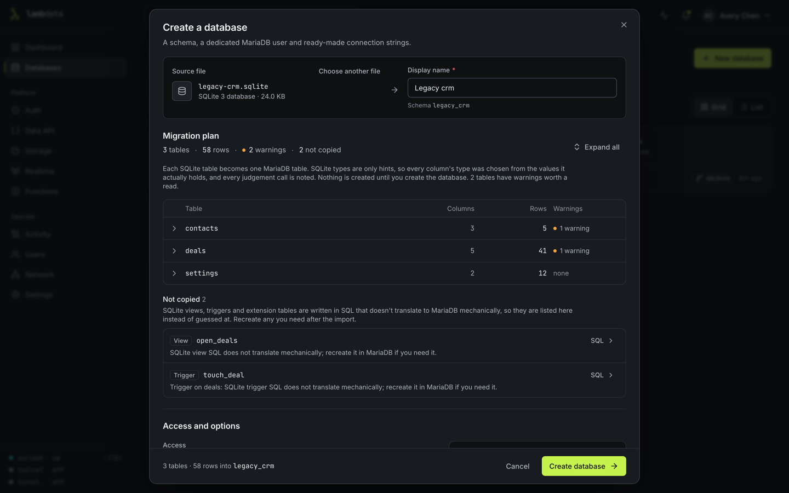

# Create a database from a file

You can turn a file into a LambData database, or load a file into an existing one in place of what it holds. Two kinds of file are accepted:

- **A SQLite 3 database**, whatever its name: `.db`, `.sqlite`, `.sqlite3` or anything else. A Garry's Mod server's `sv.db` is a typical example. LambData recognises the file by its contents, not its name.
- **A MySQL or MariaDB dump** made with `mysqldump` or `mariadb-dump`, as plain `.sql` or gzip-compressed `.sql.gz`.

Upload the file itself, not a `.zip` of it. Anything else (a PostgreSQL dump, a `sqlite3 .dump` text file, a SQL Server script, CSV, JSON, an archive) is refused with a message saying what the file looks like and what to upload instead.

## Copy a SQLite file safely

If the program that writes the SQLite file is running, its newest changes can still be in a separate `-wal` file next to it, and a copy of the `.db` alone can miss them. Stop the program (for a game server, stop the server) before you copy the file. If it has to keep running, run `PRAGMA wal_checkpoint(TRUNCATE)` on the file first so those changes are written into it.

## Create a new database

1. On **Databases**, choose **New database**, then **Import**. The command palette (press `/`) has **Import database from file** too.
2. Drop the file or browse for it. It uploads, then LambData reads it and shows a plan. Nothing is created yet.
3. Read the plan (below), give the database a name, and choose its access options and whether it is versioned (on by default here).
4. Click **Create database**. The new database gets its own MariaDB user and password, shown once, like any other database, and a first checkpoint "Imported from <file name>".

If loading fails partway, or LambData restarts during the import, the new database is kept, empty (anything partly loaded is removed at the next start), so you can try again with **Replace data from file** or delete it.

## Replace the contents of an existing database

On the database's **Import** tab, choose a file, read the plan and click **Replace data**. The file is loaded into a scratch copy first; your database keeps working meanwhile. Then, for a short moment, the database is closed to writes while LambData saves a safety checkpoint ("Before replacing data from a file") and swaps the new tables in. To undo, roll back to that checkpoint on the History tab.

- If the file fails to load, or LambData restarts before the new tables are swapped in, the database is not changed.
- The swap works like a rollback's: the database is closed to its own account for a moment, LambData checks that nothing else changed it since the safety checkpoint, and the job says how many of the database's own connections were closed. See [Roll back](checkpoints.md#roll-back).
- Views, triggers and routines of the old contents that the file does not define are removed with the old tables, and the result says so.
- Admins and the database's owner can replace data. Viewers cannot import at all.

The Import tab also lists every file loaded into the database, newest first.

## What the SQLite plan shows

Each SQLite table becomes one MariaDB table. The plan lists the tables with their row and column counts and any warnings; expand a table to see each column's SQLite declaration, the values actually found, the MariaDB type chosen and why, plus its indexes and foreign keys and the `CREATE TABLE` statement.

SQLite treats declared types as hints and will store any value in any column. So LambData chooses each column's type from the values it actually holds:

| What the column holds | MariaDB type |
|---|---|
| Whole numbers | `BIGINT`. Every 64-bit integer is copied exactly, including SteamID64 values such as `76561198000000008`. |
| Only 0 and 1, declared as a boolean | `TINYINT(1)` |
| `INTEGER PRIMARY KEY` (the SQLite row id) | `BIGINT AUTO_INCREMENT`, continuing after the highest id |
| Decimal numbers | `DOUBLE`, or `DECIMAL(p,s)` when declared that way and every value fits |
| Dates written exactly as `YYYY-MM-DD` or `YYYY-MM-DD HH:MM:SS`, in a column declared as a date | `DATE` or `DATETIME` |
| Text | `VARCHAR(n)` when the column is part of an index or key, or its declared length fits every value; otherwise `TEXT`, `MEDIUMTEXT` or `LONGTEXT` by size |
| Blobs, or text that is not valid UTF-8 | binary, so the bytes are kept unchanged |
| A mix of kinds | text, with numbers kept as their exact decimal text |

Text is compared byte by byte, as SQLite does, so keys such as `abc` and `ABC` stay different. `COLLATE NOCASE` columns become case-insensitive in MariaDB. Each judgement call is written next to the column in the plan.

Indexes and foreign keys are added after the rows are loaded. One that MariaDB cannot create (for example a foreign key that some rows break, which SQLite allows) is skipped and the plan or result says why.

Views, triggers and virtual tables are listed under **Not copied** with their SQL, because SQLite's SQL does not translate to MariaDB mechanically. Re-create the ones you need afterwards.

The Data API returns integers too large for JavaScript (such as SteamID64) as strings, so no digits are lost.

## SQL dumps

A dump is loaded with access to the target database only.

- `CREATE DATABASE` and `USE` for the dump's own database are skipped; everything loads into the database you chose. A dump that switches to a second database is refused: export one database at a time.
- `DEFINER` clauses are rewritten so views, triggers and routines belong to the database's own user.
- `SQL_LOG_BIN` and `GTID_PURGED` settings are skipped.
- `GRANT`, `REVOKE` and `CREATE USER` statements stop the load, because the dump cannot change accounts.
- A dump from MySQL 8 that uses `utf8mb4_0900_*` collations gets a warning; re-export with `utf8mb4_unicode_ci` if loading fails on them.

## Limits

| Limit | Default | Change it with |
|---|---|---|
| Largest file | 2 GB | `LAMBDATA_IMPORT_MAX_BYTES` (for example `5GB`) |
| Uploads waiting to be imported, per user | 5 | `LAMBDATA_IMPORT_MAX_PENDING_UPLOADS` |
| Total size of those uploads, per user | twice the largest file | `LAMBDATA_IMPORT_MAX_PENDING_BYTES` |

An upload that is not used is deleted after 24 hours. Uploads and imports are also refused when they would leave less free space on the data volume than the floor (see [SECURITY.md](../SECURITY.md#limits)). `GET /api/imports/limits` returns the largest file size the server accepts.
