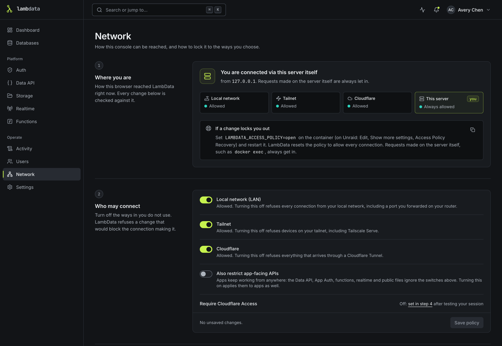

# Network access

LambData's console can be reached three ways: on your local network, over a Tailscale tailnet, or through a Cloudflare Tunnel protected by Cloudflare Access. You can use any combination, and you can lock the console to just the ones you chose. Everything on this page is set on the **Network** page, which only admins can change.

Out of the box nothing is restricted: every connection is allowed, as in earlier versions. Upgrading does not change that. The policy only changes when an admin changes it.

> The MariaDB port (3307 by default) is separate from the console. Tunnels and Tailscale Serve carry the console only. Database clients still connect over the LAN or the tailnet, and the access policy below does not apply to them. Use each database's "connections from" setting for that.

## How LambData sees a connection

Every request is put in one of four groups. The **Where you are** card at the top of the Network page shows yours.

| Group | What it means |
|---|---|
| **This server** (loopback) | The request came from the machine LambData runs on (inside the container, for Docker) with no proxy in between, and its `Host`, `Origin` and `Referer` name only this machine. Always allowed, and exempt from the setup token: it is the way back in if you lock yourself out. `LAMBDATA_TRUST_LOOPBACK=0` turns this group off ([below](#a-forwarder-on-the-same-machine)). |
| **Tailnet** | The client address is a Tailscale address (`100.64.0.0/10` or `fd7a:115c:a1e0::/48`), or the request came through Tailscale Serve. |
| **Cloudflare** | The request carries Cloudflare's headers and arrived from a cloudflared that LambData runs itself or from a trusted proxy (see [Running elsewhere](#or-point-an-existing-cloudflared-at-it-running-elsewhere)). |
| **LAN** | Everything else, including a port you forwarded on your router. |

Two cases are treated with extra suspicion, so that a header can never make a request more trusted than where it came from:

- A request with Cloudflare headers that came from an address LambData does not trust as a proxy must pass **both** the Cloudflare rule and the LAN rule. The Network page shows a warning naming that address.
- A request that came through Tailscale **Funnel** comes from the public internet. It must pass both the Cloudflare rule and the rule for where Funnel delivered it (the LAN rule), and the Network page warns about it.

Forwarding headers (`X-Forwarded-For`, `X-Forwarded-Proto`, `X-Forwarded-Host`, `Cf-Connecting-Ip`) are only believed when they come from a trusted proxy. Loopback counts as a trusted proxy unless `LAMBDATA_TRUST_LOOPBACK=0` is set. The same rule decides the client address used for sign-in rate limits and whether the connection counts as HTTPS. Session cookies get the `Secure` flag on their own whenever you use the console over HTTPS (a tunnel, Tailscale Serve, or any HTTPS reverse proxy), so `LAMBDATA_COOKIE_SECURE=1` is not needed for that.

## The access policy

Under **Who may connect**:

- **Local network (LAN)**, **Tailnet**, **Cloudflare**: which groups may use the console. A blocked request gets HTTP 403 with a short explanation. `/api/health` always answers, so Docker health checks keep working.
- **Also restrict app-facing APIs**: off by default. While it is off, the parts of LambData your applications call (the Data API, App Auth sign-up, token and user, function invocations, Realtime, public storage files) stay reachable from every group, so apps on your LAN keep working after you lock down the console. Turn it on to apply the policy to those too.
- **Require Cloudflare Access**: set in the Cloudflare Access step (below). A Cloudflare request must then carry a valid Cloudflare Access token; Cloudflare's headers alone are not enough. While **Also restrict app-facing APIs** is off, the Network page warns that the Data API, App Auth, functions, Realtime and public Storage files can still be reached through Cloudflare without an Access session, protected only by their own tokens and policies.

LambData refuses a policy change that would block the connection making it, and says which group you are on. Make the change from a connection the new policy allows: for example, switch off LAN while connected through the tunnel.

## Behind a reverse proxy

If you put the console behind your own reverse proxy (Nginx Proxy Manager, Caddy, Traefik, SWAG and so on), it usually works as it is: LambData accepts a console request whose `Origin` matches the address the browser used. If the console instead answers "Request blocked: it was sent from ..., which is not an address of this LambData server", the proxy changes the `Host` header. Either add the public address, for example `https://db.example.com`, under **Public URLs** on the Network page (in the Cloudflare Tunnel step) or in `LAMBDATA_EXTRA_ORIGINS`, or, if the proxy sends `X-Forwarded-Host`, list the proxy's address under **Trusted proxies**: `X-Forwarded-Host` is only believed from a trusted proxy. Public URLs are origins only, without a path. The first one is also used for the console links in [notifications](notifications.md).

To LambData, a reverse proxy on another address of your network is a LAN client.

### A forwarder on the same machine

A proxy or port forwarder running on the same machine as LambData (a bare `proxy_pass`, `socat`, an SSH tunnel) makes remote visitors look like the server itself, unless it adds forwarding headers. LambData treats a request from this machine whose `Host`, `Origin` or `Referer` names another host as coming from the local network, not from the server itself, so it is asked for the setup token and follows the LAN rule. The Network page then warns: "LambData has received N request(s) from this machine addressed to ..., which is not a name of this machine. Something on this machine is forwarding remote traffic to LambData without adding forwarding headers, ...".

That check relies on the forwarder passing the visitor's `Host` through. To be sure, do one of these:

- make the forwarder add `X-Forwarded-For` (a proxy on another address must also be listed under **Trusted proxies**); or
- set `LAMBDATA_TRUST_LOOPBACK=0` (also accepts `false`, `no` or `off`). Then no connection from this machine is treated as the server itself: nothing skips the setup token or the access policy that way, and loopback is no longer an implicit trusted proxy. A managed Cloudflare Tunnel and Tailscale Serve both reach LambData from this machine, so with this setting add `127.0.0.1` under **Trusted proxies**, or their visitors count as LAN. The console shows the **Trusted proxies** field when the tunnel is set to "Running elsewhere" or a proxy is already listed. `LAMBDATA_ACCESS_POLICY=open` still works for recovery.

## Option 1: LAN only (the default)

Leave the policy as it is. To be explicit, turn off Tailnet and Cloudflare.

Docker: publish the console port as usual (`-p 4317:4317`, or the Unraid template's default).

## Option 2: Tailnet only

1. Put LambData on your tailnet.
   - **Unraid 7.2 or newer**: edit the container, enable **Use Tailscale**, pick a hostname, and leave userspace networking on (see [Unraid deployment](unraid.md)). In this mode the Network page shows Tailscale read-only and Unraid manages it.
   - **Elsewhere**: install Tailscale on the host and use **Connect** on the Network page, optionally with an auth key. The key is handed to `tailscale up` through a temporary file, never on the command line, and is not logged or stored.
2. Optional: turn on **Tailscale Serve** for HTTPS at `https://<host>.<tailnet>.ts.net`. Your tailnet needs MagicDNS and HTTPS certificates enabled. On Unraid, select **Serve** with port `4317` in the template instead.
3. Open the console over the tailnet and check that **Where you are** says Tailnet.
4. Turn off **Local network** (and **Cloudflare**). Save from the tailnet connection.

Never use Tailscale **Funnel** for the console. Funnel publishes it on the public internet.

Docker: once you no longer need LAN access, stop publishing 4317 (remove the port mapping). Tailnet traffic reaches the container directly.

## Option 3: Cloudflare Tunnel with Cloudflare Access

A tunnel by itself only adds a way in. The protection comes from Cloudflare Access in front of it, and from LambData refusing requests that did not come through it. There is deliberately no "quick tunnel" option: an unauthenticated public address for a database console is too easy to get wrong.

### Create the tunnel

1. In Cloudflare **Zero Trust**, **Networks**, **Tunnels**, create a tunnel of type **Cloudflared**. Copy its token. Pasting the whole install command is fine; LambData picks the token out of it.
2. Add a **public hostname** for it, for example `db.example.com`.
   - Managed by LambData (below): service `http://localhost:4317`.
   - Running elsewhere: whatever address that cloudflared uses to reach LambData, for example `http://lambdata:4317` on a shared Docker network.

### Run it from LambData ("Managed here")

Choose **Managed here**, paste the token, save, then **Start**. LambData runs `cloudflared tunnel --no-autoupdate run` and passes the token in the `TUNNEL_TOKEN` environment variable, never on the command line. The token is stored encrypted and never shown again, only "configured". cloudflared is restarted with backoff if it exits, logs to `<data folder>/logs/cloudflared.log`, and stops when LambData stops. It starts again at boot if you left it running. The Docker image includes cloudflared; elsewhere, install it yourself (until then the page reports it as not installed). Any `TUNNEL_*` environment variables you give the container (for example `TUNNEL_TRANSPORT_PROTOCOL=http2` on networks that block QUIC) are passed through to cloudflared.

Docker: cloudflared runs inside the container, so the console port does not need to be published at all. If you still want it on the LAN for setup, publish it on loopback only (`-p 127.0.0.1:4317:4317`; on Unraid, under **Extra Parameters**) or keep the LAN rule switched off.

LambData refuses to stop or turn off the managed tunnel while you are connected through it and the policy allows no other way in.

### Or point an existing cloudflared at it ("Running elsewhere")

Many Unraid users already run cloudflared as its own container. Choose **Running elsewhere**, then:

1. Open the console through the tunnel. **Where you are** says Cloudflare, but from a private address such as `172.18.0.5`, and the page warns that no trusted proxy is set. That address is the cloudflared container as LambData sees it. Until you trust it, tunnel visitors must pass both the Cloudflare and the LAN rule, and all of them appear to come from that address.
2. Add that address under **Trusted proxies** and save. **Where you are** should now show Cloudflare with your real public address. Prefer the single address over a whole range: every trusted address may claim to be any client. Putting both containers on a dedicated Docker network and giving cloudflared a fixed address keeps this stable.

**Require Cloudflare Access** cannot be saved together with "Running elsewhere" until a trusted proxy is set.

### Add Cloudflare Access

1. In **Zero Trust**, **Access**, **Applications**, add a **Self-hosted** application for `db.example.com` with a policy listing who may sign in (for example your email).
2. Copy the application's **Audience (AUD) tag** and your team domain (`<team>.cloudflareaccess.com`, shown under **Settings**, **Custom Pages**, or in the Access sign-in address).
3. On the Network page enter both, save, and add `https://db.example.com` under **Public URLs**.
4. Open `https://db.example.com`, sign in through Access, then sign in to LambData. Access is an outer gate; the console sign-in is still required.
5. Press **Test my session**. It checks the Access token on that request (RS256 signature against your team's published keys, audience, issuer and expiry) and shows the email it belongs to.
6. Turn on **Require Cloudflare Access**, then turn off **Local network** (and **Tailnet** if you do not use it). Save from the tunnel connection.

## Recovery

If you lock yourself out:

- **Environment variable**: set `LAMBDATA_ACCESS_POLICY=open` on the container and restart it (on Unraid: edit the container, show more settings, **Access Policy Recovery**). At startup LambData resets the stored policy to "allow everything" and records that in the audit log. While the variable is set the policy cannot be edited. Remove the variable and restart, then set the policy again.
- **From the server itself**: loopback is always allowed, unless `LAMBDATA_TRUST_LOOPBACK=0` is set. With Docker, `docker exec <container> bun -e "fetch('http://127.0.0.1:4317/api/health').then(r => r.text()).then(console.log)"` reaches LambData from inside the container. A port published on the host's loopback does not count: through Docker's port mapping the connection arrives from the Docker gateway, which is LAN.

## Reference

API under `/api/network` (all need a signed-in user; everything except `GET /status` needs an admin):

| Method and path | Purpose |
|---|---|
| `GET /status` | Current connection, policy, warnings, tunnel, Access and Tailscale state. Never includes secrets. |
| `PUT /policy` | Save the access policy (refused if it would block the caller). |
| `PUT /public-urls` | Public URLs (added to the browser allow-list) and trusted proxies. |
| `PUT /cloudflare/tunnel` | Mode (`off`, `managed`, `external`) and token. An empty token clears it. |
| `POST /cloudflare/tunnel/start`, `POST /cloudflare/tunnel/stop` | Control the managed tunnel. |
| `PUT /cloudflare/access` | Team domain and audience tag (both, or both `null`). |
| `POST /cloudflare/access/test` | Verify the current request's Access token and return its email. |
| `POST /tailscale/serve` | `{ "enabled": true }` or `false`. Read-only when Unraid manages Tailscale. |

`/api/tailscale/status`, `/up` and `/down` keep working as before.

Environment: `LAMBDATA_ACCESS_POLICY=open` (recovery), `LAMBDATA_TRUST_LOOPBACK=0` (treat no connection from this machine as local), `LAMBDATA_EXTRA_ORIGINS` (comma-separated extra console addresses), `LAMBDATA_CLOUDFLARED_BIN` and `LAMBDATA_TAILSCALE_BIN` (use a specific binary instead of the one on `PATH`; a path that does not exist makes LambData treat the tool as not installed).
