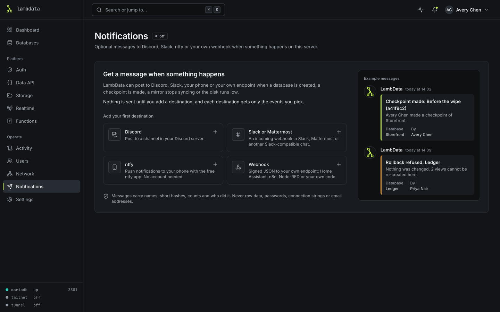
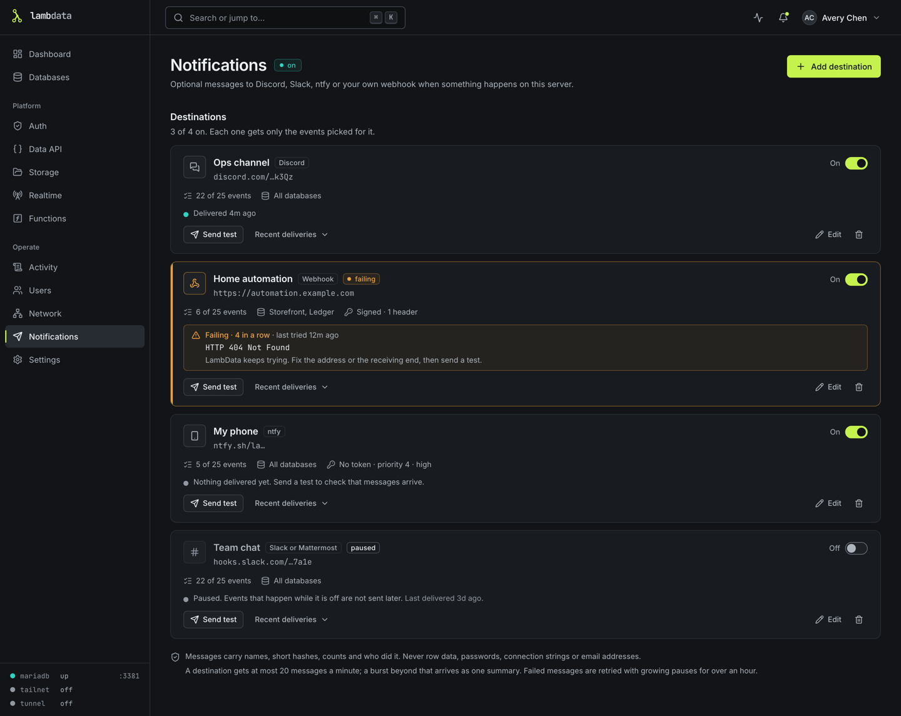

# Notifications

LambData can send a message when something happens on your server: a database is created, a checkpoint is made, a rollback is refused, a mirror stops syncing, the disk runs low. Messages go to Discord, to Slack or Mattermost, to your phone through ntfy, or to your own endpoint as a signed webhook (Home Assistant, n8n, Node-RED or your own code).

Notifications are optional and off by default. Nothing is sent until an admin adds a destination, and each destination gets only the events picked for it. Only admins see and manage notifications; the page is **Notifications** under **Operate** in the sidebar.



## Add a destination

On **Notifications**, pick one of the four kinds (or **Add destination** once you have one). The dialog has a **Where do I get this?** guide for each kind; the steps below are the same.

Every destination has:

- a **name**, shown in the list;
- the **address** to send to, stored encrypted and never shown again (the list shows a masked version);
- the **events** it gets ([Choose events](#choose-events-and-databases));
- the **databases** it follows;
- an **icon** ([Icon](#icon));
- **Skip sync messages when nothing changed** ([below](#skip-sync-messages-when-nothing-changed)), off unless you turn it on;
- an **On/Off** switch. While a destination is off, nothing is sent to it, and events that happen meanwhile are not sent later.

LambData runs in a container, so `localhost` there is the container itself. To reach something else on your server, use the server's network address instead.

### Discord

1. In Discord, open your server, hover over the channel that should get the messages and click the gear: **Edit Channel**.
2. Open **Integrations**, **Webhooks**, **New Webhook**. No Integrations tab? You need the **Manage Webhooks** permission in that server.
3. Click **Copy Webhook URL** and paste it into LambData. Its name and picture do not matter: LambData sets its own on every message.

The URL must start with `https://discord.com/api/webhooks/` or `https://discordapp.com/api/webhooks/`. Anyone with this URL can post in the channel, which is why LambData stores it encrypted.

### Slack or Mattermost

Slack:

1. Go to `api.slack.com/apps` and choose **Create New App**, **From scratch**. Name it LambData and pick your workspace.
2. Under **Features**, open **Incoming Webhooks** and switch it on.
3. Click **Add New Webhook to Workspace**, pick the channel and allow it.
4. Copy the **Webhook URL**, which starts with `https://hooks.slack.com/services/`, and paste it into LambData.

Mattermost:

1. Open the product menu, **Integrations**, **Incoming Webhooks**, **Add Incoming Webhook**.
2. Pick the channel, save, and copy the URL it shows. Paste it into LambData.
3. To show LambData's name and icon, a Mattermost admin must allow integrations to override usernames and profile picture icons (**System Console**, **Integrations**).

Other Slack-compatible chats work the same way. The address must use `https://` unless it points at a private address on your network.

### ntfy (push to your phone)

1. Install the **ntfy** app on your phone (Android or iOS), or open `ntfy.sh` in a browser. No account is needed.
2. Pick a topic name in LambData, or press **Suggest one**. The topic is the address: on the public server anyone who knows it can read the messages, so make it hard to guess. Topics are 1 to 64 letters, digits, `-` or `_`.
3. In the app, tap **+** and subscribe to the same topic. If you run your own ntfy server, enter its address in both places.

The server is `https://ntfy.sh` unless you enter another one. Two optional settings:

- **Access token**: only if your server requires sign-in. ntfy lists tokens under Account; they start with `tk_`. It is stored encrypted.
- **Priority**: how loudly your phone announces messages, from 1 (no sound) to 5 (long bursts, stays on screen). By default it follows the event: problems are high, routine news is the phone's normal alert.

### Webhook (your own endpoint)

1. Create something that accepts a `POST` with a JSON body. In Home Assistant, an automation with a **Webhook** trigger gives you an address like `http://homeassistant.local:8123/api/webhook/your-id`; n8n and Node-RED have a Webhook node.
2. Paste its address into LambData. Any 2xx answer counts as delivered; on errors LambData tries again with growing pauses for about an hour.
3. Optionally add a **signing secret** (**Generate** makes one), so your endpoint can check that a message really came from LambData. Copy it when you create it: it is not shown again.

You can also add up to 10 **custom headers**, for an endpoint that wants a key in a header. Their values are stored encrypted. The body, headers and signature are described in the [webhook reference](#webhook-reference) below.

## Choose events and databases

The event list is grouped (Databases, Checkpoints, Mirrors, Imports, Access, Access tokens, Health), with a select-all per group and **Use defaults**.

A new destination starts with everything that a person did or that needs a person's attention. A few routine events start off because they can be noisy:

- **Automatic checkpoint**: scheduled checkpoints send one message per database every time they run;
- **Sync finished**: a mirror that syncs every five minutes sends a message every five minutes, unless the destination [skips syncs that changed nothing](#skip-sync-messages-when-nothing-changed);
- **Disk space recovered**;
- **Access token created** and **Access token revoked**.

Turn them on if you want a full activity feed.

**Databases**: a destination follows all databases (including ones created later) or only the ones you pick. Events that are not about one database, such as console users, the network policy, access tokens, MariaDB and disk space, are always sent to a destination that selected them. **Approval needed** is always sent too, even when the approval is about a database the destination does not follow.

All events, with the default for each:

| Group | Event | What it means | On by default |
|---|---|---|---|
| Databases | Database created | Someone created a database, from scratch or from an uploaded file. | yes |
| Databases | Database deleted | Someone deleted a database together with its data and checkpoints. | yes |
| Databases | Password rotated | Someone generated a new password for a database; apps using the old one can no longer connect. | yes |
| Checkpoints | Checkpoint made | Someone made a checkpoint by hand, with its message, short hash and what changed since the previous checkpoint. | yes |
| Checkpoints | Automatic checkpoint | A scheduled, sync, import or safety checkpoint was made, with what changed since the previous checkpoint. | no |
| Checkpoints | Checkpoint or rollback failed | A checkpoint, automatic or made by hand, or a rollback could not finish. | yes |
| Checkpoints | Rolled back | A database was rolled back to one of its checkpoints. | yes |
| Checkpoints | Rolled back with errors | A rollback brought the tables back, but some views, triggers or routines could not be re-created. | yes |
| Checkpoints | Rollback refused | A rollback was stopped before anything changed. | yes |
| Checkpoints | Checkpoint deleted | Someone deleted a checkpoint. | yes |
| Mirrors | Sync finished | A mirror copied its source again, with how many rows were added, removed and changed ([Rows changed by a sync](#rows-changed-by-a-sync)). | no |
| Mirrors | Sync failed | A mirror could not copy its source. | yes |
| Mirrors | Sync recovered | A mirror synced successfully after one or more failures. | yes |
| Imports | Import finished | A database was created from a file, or its data was replaced from one. | yes |
| Imports | Import failed | An import from a file did not finish. | yes |
| Access | User added, User removed | An admin added or removed a console user. | yes |
| Access | Data API opened, Data API closed | Someone opened or closed a database to the Data API. | yes |
| Access | Access policy changed | The rules for which networks can reach the console changed. | yes |
| Access tokens | Access token created | An admin created an access token, so an agent or script can use the management API. | no |
| Access tokens | Access token revoked | An admin revoked an access token. Anything still using it is refused from then on. | no |
| Access tokens | Approval needed | An access token set to ask first wants to do something (delete a database, roll back, run a `DROP`, ...) and waits until an admin approves or denies it. The link opens the approvals page. | yes |
| Health | MariaDB down, MariaDB back | The database server stopped unexpectedly or failed to start, and when it runs again. A deliberate stop sends nothing. | yes |
| Health | Disk space low | Free space on the data volume fell below the floor. Sent once when it crosses the floor, not on every check. | yes |
| Health | Disk space recovered | Free space is back above the floor (with a 5% margin, so a volume hovering at the floor does not send repeated messages). | no |
| Health | Snapshot not converted | An old KilnDB snapshot could not be turned into a checkpoint. Sent once per snapshot, not on every retry. | yes |

## Rows changed by a sync

A **Sync finished** message says what the sync changed in the mirror, per table:

```text
Shop synced from its source and copied 129 tables. 3 tables changed: 1,204 rows added, 12 removed, 40 changed.
• players: 4,310 → 5,512 rows
• orders: 1,150 added, 0 removed, 38 changed
• customers: 54 added, 12 removed, 2 changed
```

The largest changes come first. A message lists at most five tables and ends with "and N more." when there are others; tables that did not change are only counted. When no table changed, the message ends with "Nothing changed." The **Sync** tab of the mirror and the job's result show the same summary, with a short hint next to a table that was only counted saying why.

How each table is measured:

- **Row by row** (for example `orders: 1,150 added, 0 removed, 38 changed`), when the table exists before and after the sync with the same columns, is an InnoDB table, and has a primary key or a unique key whose columns are all `NOT NULL`. A row whose key is only in the new copy is added, one only in the old copy is removed, and one in both with any column different is changed (`NULL` compares correctly).
- **Before and after** (for example `players: 4,310 → 5,512 rows`) for every other table: it has no usable key, its columns changed, it is not a plain InnoDB table, it is larger than the row limit, the time limit was reached before it could be compared row by row, or the row-by-row comparison is turned off. A table whose row count stayed the same is still checked with a checksum, so it is reported only if its rows differ.
- A new table reads `new table, 812 rows`, a removed one `removed (had 812 rows)`, and a table whose definition changed gets "(structure changed)". The first sync into an empty mirror reports every table as new.
- **Not compared**: a table the comparison did not reach before its time limit, and whose change the sync could not tell from what it already knew. Such tables are only counted, and the message ends with "N tables were not compared because the sync's time limit for comparing was reached." If no compared table changed, the message reads "No changes in the tables that were compared." instead of "Nothing changed."

The totals after "changed:" add up the tables compared row by row. When none of them changed, the message gives the overall row difference instead, for example "+1,202 rows in all"; that difference is left out when some tables were not compared.

The comparison runs while the old and the new copy of the mirror both exist, before the new one is swapped in. It only reads and keeps nothing closed. Tables whose row counts and checksums the sync already knows are settled from those without extra work; the rest are compared smallest first. If the comparison fails, the sync is not affected; the message then has no change summary. PostgreSQL sources are compared the same way, inside MariaDB.

Two limits keep it from making syncs slow:

| Variable | Default | Meaning |
|---|---|---|
| `LAMBDATA_SYNC_DIFF_MAX_ROWS` | `2000000` | Tables with more rows are only counted, not compared row by row. `0` turns the row-by-row comparison off; tables are then counted and checked with a checksum only. |
| `LAMBDATA_SYNC_DIFF_MAX_SECONDS` | `30` | Time one sync may spend on all of its comparing work: counting, checksums and row-by-row comparisons. Tables not reached by then are reported as not compared. `0` turns the comparing work off: only tables the sync can settle from what it already knows are reported, and the rest count as not compared. |

Both also accept the old `KILNDB_*` prefix.

**Checkpoint messages** (**Checkpoint made** and **Automatic checkpoint**) end with the net change since the database's previous checkpoint, from what checkpoints already record: for example "Since checkpoint a41f9c2: 2 tables changed, +120 rows." or "Nothing changed since checkpoint a41f9c2." A webhook gets the same in `data`: `previousCheckpointId`, `tablesChanged`, `rowDelta` and `codeChanged` (views, triggers, routines or events changed). For the first checkpoint of a database and for converted KilnDB snapshots the first three are `null` and `codeChanged` is left out.

### Skip sync messages when nothing changed

Each destination has a switch **Skip sync messages when nothing changed** (off by default). When it is on, that destination does not get:

- a **Sync finished** whose comparison found no changed table, left no table uncompared, and that finished without errors;
- an **Automatic checkpoint** that holds nothing new since the checkpoint before it.

Failed syncs, recoveries, syncs that finished with errors, syncs with tables that were not compared, syncs whose changes could not be measured and every other event still arrive. The destination's card shows "Skips syncs that changed nothing" while it is on.

## Icon

Chat messages show the LambData icon and the sender name "LambData" by default. To use your own picture, choose **Use your own** and enter an `https://` address of a square PNG or JPEG; chat apps download it themselves. For ntfy the icon shows on phones that support it; a webhook receives it as `iconUrl` in the payload.

The default icon is `https://raw.githubusercontent.com/lambdatadb/lambdata/main/apps/web/public/lambdata-mark.png`.

## Send a test and read the deliveries

**Send test** sends one message titled "Test message from LambData" right away and shows the result: sent, or the status and reason (for example "HTTP 404 Not Found" or "connection refused"). It works on a destination that is switched off.

**Recent deliveries** lists the newest messages for a destination: their status, event, title, time, attempts and last error. The list refreshes itself while something is waiting.

| Status | Meaning |
|---|---|
| Queued | Waiting to be sent, or waiting for its next retry. |
| Sending | Being sent now. |
| Sent | The destination answered with a 2xx. |
| Failed | Every attempt failed, or the destination answered with an error that is not worth retrying. |
| Dropped | Not sent: combined into a summary ([Limits](#limits)), or the destination was switched off while it waited. |



## When a destination fails

Each destination shows its health:

- **Nothing delivered yet**: nothing has arrived successfully so far. Send a test.
- **Delivered**: the last message arrived.
- **Failing**: 3 or more messages in a row could not be delivered, after their retries (a failed test counts too). The destination is marked amber, the dashboard mentions it, and the last error is shown.

A failing destination keeps getting attempts; one success makes it healthy again. Fix the address or the receiving end, then send a test.

The error is a short text LambData writes itself, such as "HTTP 404 Not Found", "connection refused", "timed out after 10 seconds", "TLS certificate problem", "HTTP 302: redirect not followed" or "refused: ..." for an address that is not allowed. It never contains the response body or the destination's URL.

A slow or dead destination never slows down or fails the operation that caused the event: events are queued and sent in the background.

## What messages contain, and what they never contain

Messages carry names (including the names of tables a sync changed), short checkpoint hashes, counts, who did it (their display name, or for an access token its name followed by "(access token)") and, when you set one, a link into the console. The link uses the first public URL listed on the **Network** page; without one, messages have no link.

Messages never contain:

- row data, raw SQL, passwords, connection strings, tokens, email addresses or file system paths;
- error text from MariaDB, the mirror's source or an import ("Open the console to see why" instead);
- a mirror's source host or database, an uploaded file's name, or a snapshot's file path.

Names and messages that people typed (database names, checkpoint messages, display names) are cut to 200 characters, approval summaries to 150, token names to 100 and table names to 64; anything that looks like an email address becomes `[email]`, and credentials such as `user:password@` or `password=...` are masked. A user without a usable display name is shown by role, for example "An admin". In chat messages this text is escaped so it cannot mention anyone (`@everyone`, `@here`, `@channel`), add links or change formatting.

## Webhook reference

Every message is a `POST` with a JSON body.

### Headers

| Header | Value |
|---|---|
| `Content-Type` | `application/json` |
| `User-Agent` | `LambData` |
| `X-LambData-Event` | The event type, for example `checkpoint.created`; `test` for a test message; `summary` for a [summary](#summaries). |
| `X-LambData-Delivery` | The delivery id. It stays the same across retries, so use it to drop duplicates. |
| `X-LambData-Timestamp` | Unix time in seconds, new on every attempt. |
| `X-LambData-Signature` | `sha256=<hex>`, only when a signing secret is set. |

Your custom headers are sent too.

### Body

```json
{
  "version": 1,
  "product": "lambdata",
  "id": "evt_3f2a9c0d4b1e4a7f9c2d8e6b5a4f3c21",
  "type": "checkpoint.created",
  "group": "checkpoints",
  "severity": "success",
  "occurredAt": "2026-11-10T14:30:00.000Z",
  "title": "Checkpoint made: Before the wipe (a41f9c2)",
  "message": "Avery Chen made a checkpoint of Orders. It holds 4 tables and 1,200 rows. Since checkpoint 7c03e5b: 2 tables changed, +120 rows.",
  "actor": { "displayName": "Avery Chen" },
  "database": { "id": "db_5c1e7a2b9d8f4e3a", "name": "orders", "displayName": "Orders" },
  "data": {
    "databaseId": "db_5c1e7a2b9d8f4e3a",
    "checkpointId": "cp_9b8a7c6d5e4f",
    "hash": "a41f9c2",
    "tables": 4,
    "rows": 1200,
    "verified": false,
    "previousCheckpointId": "cp_1a2b3c4d5e6f",
    "tablesChanged": 2,
    "rowDelta": 120,
    "codeChanged": false
  },
  "link": "https://lambdata.example.com/databases/db_5c1e7a2b9d8f4e3a/history/cp_9b8a7c6d5e4f",
  "iconUrl": "https://raw.githubusercontent.com/lambdatadb/lambdata/main/apps/web/public/lambdata-mark.png"
}
```

| Field | Meaning |
|---|---|
| `version` | Always `1` for this format. |
| `product` | Always `"lambdata"`. |
| `id` | The event id. |
| `type` | The event type (see the table above for all of them, by label), `test` or `summary`. |
| `group` | `databases`, `checkpoints`, `mirrors`, `imports`, `access`, `agents` (shown as Access tokens), `health`, or `test` / `summary`. |
| `severity` | `info`, `success`, `warning` or `error`. |
| `occurredAt` | When it happened, ISO 8601 in UTC. |
| `title`, `message` | The same text the chat messages show, as plain text. |
| `actor` | Who did it (`displayName`), or `null` for something LambData did on its own. For an access token, its name followed by " (access token)". |
| `database` | The database it is about, or `null`. |
| `data` | Extra facts for this event type: ids, short hashes, counts. Values are strings, numbers, booleans or `null`. |
| `changes` | Only on `sync.finished`, when the sync's changes were measured: the changed tables ([below](#row-changes-in-the-payload)). Absent on every other event. |
| `link` | A link into the console, or `null` when no public URL is set. |
| `iconUrl` | The destination's icon, the default unless you set your own. |

### Row changes in the payload

A `sync.finished` payload carries the totals in `data` and the changed tables in `changes`:

```json
{
  "type": "sync.finished",
  "group": "mirrors",
  "data": {
    "databaseId": "db_7d2c9e1a4b6f8035",
    "tables": 129,
    "outcome": "done",
    "codeFailures": 0,
    "jobId": "job_4e8a1c7b2d9f",
    "changesMeasured": true,
    "tablesChanged": 2,
    "tablesUnchanged": 127,
    "rowsAdded": 1150,
    "rowsRemoved": 0,
    "rowsChanged": 38,
    "rowDelta": 2352,
    "tablesNotCompared": 0
  },
  "changes": {
    "tables": [
      { "name": "players", "change": "modified", "method": "net", "schemaChanged": false, "rowsBefore": 4310, "rowsAfter": 5512, "added": null, "removed": null, "changed": null, "reason": "no-key" },
      { "name": "orders", "change": "modified", "method": "exact", "schemaChanged": false, "rowsBefore": 20400, "rowsAfter": 21550, "added": 1150, "removed": 0, "changed": 38 }
    ],
    "truncated": false
  }
}
```

In `data`: `changesMeasured` is `false` (and the other change fields are left out) when the changes could not be measured. `rowsAdded`, `rowsRemoved` and `rowsChanged` add up the tables compared row by row and are `null` when no table could be. `rowDelta` is rows after minus rows before, over all tables, and `null` when some tables were not compared. `tablesNotCompared` is how many tables the time limit left out.

Each entry of `changes.tables`:

| Field | Meaning |
|---|---|
| `name` | The table name, cleaned like other user text and cut to 64 characters. |
| `change` | `added` (new table), `removed` (table gone) or `modified`. |
| `method` | `exact` (compared row by row) or `net` (rows before and after only). |
| `schemaChanged` | `true` when the table's definition changed. |
| `rowsBefore`, `rowsAfter` | Row counts, `null` when there is no such table on that side. |
| `added`, `removed`, `changed` | Row counts for `exact`; `null` for `net`. |
| `reason` | Only for `net`: `new`, `removed`, `no-key` (no usable key), `structure` (columns changed), `too-large`, `time` (the time limit was reached; the counts come from what the sync already knew), `unsupported` (not a plain InnoDB table) or `off`. |

`changes.tables` holds at most 20 tables, largest change first; `truncated` is `true` when more tables changed than are listed. The payload `version` stays `1`: `changes` is a new field, and a receiver that ignores fields it does not know needs no change.

The event types are `database.created`, `database.deleted`, `database.password_rotated`, `checkpoint.created`, `checkpoint.auto_created`, `checkpoint.failed`, `checkpoint.rolled_back`, `checkpoint.rollback_errors`, `checkpoint.rollback_refused`, `checkpoint.deleted`, `sync.finished`, `sync.failed`, `sync.recovered`, `import.finished`, `import.failed`, `user.created`, `user.removed`, `data_api.opened`, `data_api.closed`, `network.policy_changed`, `token.created`, `token.revoked`, `approval.requested`, `mariadb.down`, `mariadb.recovered`, `disk.low`, `disk.recovered` and `snapshot.unconverted`.

### Summaries

When a destination gets more than 20 messages in a minute, the extra ones are combined into one message ([Limits](#limits)). For a webhook that message has `type: "summary"`, `group: "summary"` and the header `X-LambData-Event: summary`. Its `title` is "And N more events", its `message` lists up to five of their titles, and `data.count` (how many were combined) and `data.types` (the event types, comma-separated) describe them. `actor`, `database` and `link` are `null`.

### Check the signature

The signature is the hex HMAC-SHA256, keyed with the signing secret, of the timestamp header, a dot, and the raw request body: `<X-LambData-Timestamp>.<body>`. Use the body bytes exactly as received, before parsing the JSON. Rejecting timestamps older than five minutes stops someone from replaying an old message.

JavaScript (Node or Bun):

```js
import { createHmac, timingSafeEqual } from "node:crypto";

function verify(rawBody, headers, secret) {
  const ts = headers["x-lambdata-timestamp"];
  const expected = "sha256=" + createHmac("sha256", secret).update(`${ts}.${rawBody}`).digest("hex");
  const given = Buffer.from(headers["x-lambdata-signature"] ?? "");
  return given.length === expected.length && timingSafeEqual(given, Buffer.from(expected)) && Math.abs(Date.now() / 1000 - Number(ts)) < 300;
}
```

Python:

```python
import hashlib, hmac, time

def verify(raw_body: bytes, headers, secret: str) -> bool:
    ts = headers["X-LambData-Timestamp"]
    expected = "sha256=" + hmac.new(secret.encode(), f"{ts}.".encode() + raw_body, hashlib.sha256).hexdigest()
    fresh = abs(time.time() - int(ts)) < 300
    return fresh and hmac.compare_digest(expected, headers.get("X-LambData-Signature", ""))
```

### Changing a webhook through the API

The console edits destinations through `/api/notifications` (admins only). Stored values are never returned, so editing works like this: an omitted setting keeps the stored one; for the signing secret, `null` removes it and a new string replaces it. Custom headers are sent as one object that replaces the whole set, and a header sent with an **empty string** as its value keeps the value already stored under that name (names compare without regard to case). That is how the console keeps a header while you add or remove others. An empty value for a header that is not stored yet is refused.

Custom header names must be valid HTTP header names (at most 100 characters) and values at most 2000 characters without line breaks. These names cannot be used: `Host`, `Content-Length`, `Content-Type`, `User-Agent`, `Transfer-Encoding`, `Connection`, `Keep-Alive`, `Upgrade`, `TE`, `Trailer`, `Proxy-Connection`, and anything starting with `X-LambData-`.

## Limits

- **20 messages a minute per destination.** Beyond that, the extra messages are marked dropped and combined into one "And N more events" message, at most one a minute, so a burst (deleting ten checkpoints, say) cannot get a webhook blocked. Test messages count toward the 20 but are always sent.
- **Retries for over an hour.** Each attempt has 10 seconds. Network errors, timeouts, and answers 408, 429 and 5xx are retried after 10 seconds, 1 minute, 5 minutes, 15 minutes and 60 minutes; after the sixth attempt the message is marked failed. A `Retry-After` header from the destination replaces the wait (at least 1 second, at most 15 minutes). Other 4xx answers fail at once, and redirects are never followed.
- **One at a time, in order.** Messages to one destination are sent in order, so a message waiting for its retry holds back the later ones. Different destinations are sent to in parallel.
- **Restarts.** Waiting messages are sent after a restart. A message that was being sent when LambData stopped is sent again, so an endpoint can occasionally see the same `X-LambData-Delivery` twice.
- **History.** Each destination keeps at most 200 deliveries and nothing older than 14 days. Deleting a destination deletes its history.

## Addresses that are refused

Destinations must use `http://` or `https://`, without a user name or password in the address. LambData checks the address when you save it and again before every send, on the addresses the host name resolves to, and refuses:

- link-local addresses (`169.254.0.0/16`, `fe80::/10`) and cloud metadata addresses (`169.254.169.254`, `100.100.100.200`, `fd00:ec2::254`);
- the unspecified address (`0.0.0.0/8`, `::`), multicast (`224.0.0.0/4`, `ff00::/8`) and reserved ranges (`240.0.0.0/4`), including the same addresses written in IPv6 form;
- LambData's own API port on this machine (`127.0.0.0/8`, `::1`, `localhost`).

Private network addresses (`10.0.0.0/8`, `172.16.0.0/12`, `192.168.0.0/16`, `fc00::/7`), the tailnet range (`100.64.0.0/10`), other ports on this machine and public hosts are allowed: a Home Assistant or a self-hosted ntfy on your network is the normal case. A host name that cannot be resolved when you save is accepted and checked again at every send. LambData connects to exactly the address it checked, so a host name that changes to a refused address in between is not contacted; certificates are still checked against the original host name.
