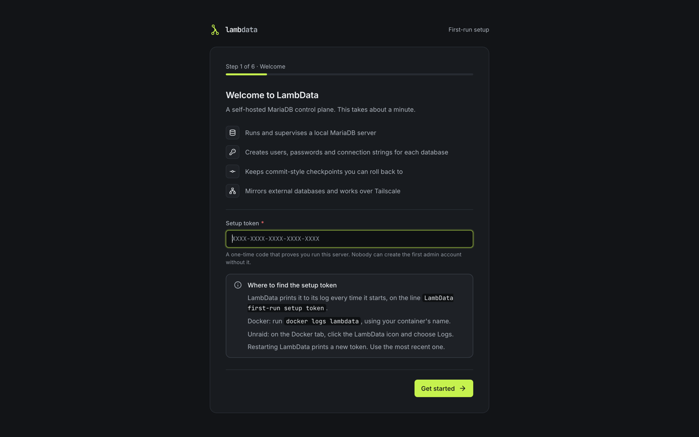

# Unraid deployment

LambData ships an Unraid Docker template that uses the published image `ghcr.io/lambdatadb/lambdata:latest`. The container keeps everything, including its Tailscale state, in one appdata folder.

## Install the template

Run this from the Unraid terminal:

```bash
mkdir -p /boot/config/plugins/dockerMan/templates-user
curl -fsSL \
  https://raw.githubusercontent.com/lambdatadb/lambdata/main/unraid/lambdata.xml \
  -o /boot/config/plugins/dockerMan/templates-user/my-LambData.xml
```

Open the **Docker** tab, click **Add Container**, choose **LambData** from the template list, and check these settings:

| Setting | Default |
|---|---|
| Repository | `ghcr.io/lambdatadb/lambdata:latest` |
| Network | `Bridge` |
| Web UI | Host `4317` to container `4317` |
| LambData Data | `/mnt/user/appdata/lambdata` to `/data` |
| Extra Parameters (advanced view) | `--stop-timeout=45` |
| Secure Cookies (advanced view) | `0` |
| Access Policy Recovery (advanced view) | empty |
| Privileged | Off |

`--stop-timeout=45` gives LambData up to 45 seconds to shut MariaDB down cleanly when the container stops; Docker's default is 10 seconds. Keep it at 30 seconds or more.

Click **Apply**.

## First start: the setup token

The setup wizard asks for a one-time setup token before it creates the first admin account. LambData prints it in the container log:

1. On the **Docker** tab, click the LambData icon and choose **Logs**.
2. Find the line `LambData first-run setup token:` and copy the code after it (five groups of four characters).
3. Open the console (click the icon again and choose **WebUI**, or go to `http://<unraid-ip>:4317`) and paste the token on the first screen.



Restarting the container before setup is finished prints a new token; use the most recent one. Once setup is done there is no token any more. The storage step shows `/data` already chosen: on Unraid that is the appdata folder you mapped.

## Upgrading from KilnDB

A container created from the KilnDB template keeps running the last KilnDB version: that image is frozen and no longer updated. Switch it to LambData yourself, after a backup.

1. Back up the appdata folder (the container is usually called `KilnDB`):

   ```bash
   docker stop KilnDB
   mkdir -p /mnt/user/backups
   tar -C /mnt/user/appdata -czf /mnt/user/backups/kilndb-before-lambdata.tar.gz kilndb
   ```

2. On the **Docker** tab, click the KilnDB icon and choose **Edit**.
3. Change **Repository** to `ghcr.io/lambdatadb/lambdata:latest`.
4. Keep `/mnt/user/appdata/kilndb` mapped to `/data`. That folder stays valid and nothing needs to be moved or renamed. The `KILNDB_COOKIE_SECURE` variable can stay too; LambData still reads every `KILNDB_*` variable.
5. Switch to the advanced view and add `--stop-timeout=45` under **Extra Parameters**.
6. Click **Apply**, then open the log to watch the first start.

If you prefer the new template, remove the KilnDB container first (this does not touch its appdata folder), add LambData from the template as above, and set **LambData Data** to `/mnt/user/appdata/kilndb`. The same appdata path keeps your data. Never run two containers on the same appdata folder.

Then read [Upgrading from KilnDB](upgrading.md) for what changes after the first start: the Data API starts closed, App Auth sign-up is off, old snapshots become checkpoints, and open browser tabs need a reload.

## Native Tailscale integration

Unraid 7.2 or newer can put the LambData container on your tailnet. LambData stays unprivileged and starts normally after Unraid's Tailscale hook has run.

1. Edit the LambData container and enable **Use Tailscale**.
2. Choose a unique Tailscale hostname.
3. Leave **Be a Tailscale Exit Node** off.
4. Leave userspace networking on unless you specifically need full tailnet DNS or outbound connectivity.
5. Optionally select **Serve** with port `4317` to reach the console over HTTPS on your tailnet. Session cookies become Secure on their own over HTTPS; the **Secure Cookies** variable can stay at `0`.
6. Click **Apply** and open the container log.
7. Follow the Tailscale sign-in link shown during the first start.

The template keeps the Tailscale state in `/data/.tailscale_state`, so the container keeps its tailnet identity across updates. While Unraid manages Tailscale, the Network page in LambData shows its status but leaves the controls to the template.

Serve and Funnel are different. Serve is only reachable from your tailnet. Funnel publishes the console on the internet; leave it off. See [Network access](network.md) for limiting the console to the tailnet.

## Database connections from other machines

By default MariaDB (port `3307`) listens inside the container, so a game server, an app on another machine or a tool such as DBeaver cannot connect yet, and the console says so next to every database address. To let them in:

1. In LambData, open **Network** and turn on **Allow database clients on other machines** in the **Database connections** card. MariaDB restarts and open database connections drop for a moment.
2. Publish the port. On the **Docker** tab, click the LambData icon and choose **Edit**.
   - If the container has a **MariaDB Port** field, set it to `3307` (or the host port you want) and click **Apply**.
   - If it has none, click **Add another Path, Port, Variable, Label or Device** at the bottom, choose **Port**, name it `MariaDB Port`, set **Container Port** and **Host Port** to `3307` and **Connection Type** to `TCP`, then **Add** and **Apply**.

LambData cannot see Docker's port mappings, so it cannot tell you when step 2 is missing. If clients are still refused, open the database's **Overview** tab: **Rejected connections** shows the address MariaDB saw and why it said no. Through Docker's port mapping or a VPN that address can be the Docker network's gateway rather than the client's own address; it is the one to put in "connections from".

Some templates have a **MariaDB Bind Address** variable (it sets `LAMBDATA_MARIADB_BIND`). When it is filled in, it decides instead of the console switch: the switch shows the value and says it comes from the container's variable. A container that already sets it to `0.0.0.0`, as earlier versions needed, keeps working that way. To use the switch instead, remove the variable from the container (the **Remove** button next to it), click **Apply**, and turn the switch on.

Only publish the port on a network you trust, and do not forward it on your router unless you mean to. See [Network access](network.md#database-connections).

## Updates

Use **Check for Updates** on the **Docker** tab. The template follows the `latest` image published from LambData's `main` branch.

To pull from the terminal instead:

```bash
docker pull ghcr.io/lambdatadb/lambdata:latest
```

Then edit the container and click **Apply**. The appdata folder is kept.

## Backups

Stop LambData before copying its appdata folder, so MariaDB's files are consistent. The folder holds MariaDB, the metadata database, checkpoints, uploaded objects, functions, the encryption key `master.key` and the Tailscale state. A backup without `master.key` cannot decrypt stored passwords and secrets.

```bash
docker stop LambData
mkdir -p /mnt/user/backups
tar -C /mnt/user/appdata -czf /mnt/user/backups/lambdata-appdata.tar.gz lambdata
docker start LambData
```

For a container upgraded from KilnDB, use its own name (for example `KilnDB`) and folder (`kilndb`).

Checkpoints are not a replacement for this backup: they live in the same folder.

## File ownership

LambData runs as user and group 999 inside the container, the same as KilnDB did. At start, if the data folder belongs to someone else, the container changes the owner of every file and folder in it that does not already belong to 999:999, and logs how many it changed. To forbid that, set `LAMBDATA_FIX_DATA_OWNERSHIP=never`: the container then stops with a message and the `chown` command to run yourself.
